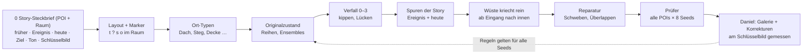

# POI Design Bible

Stand 21.11.2026 · Ava mit Daniel. Kopie des Docs „NomadGirl – POI Design Bible“ (claude.ai, Reiter „Bibel“). Die Story-Steckbriefe aller POIs stehen in [`poi_steckbriefe.md`](poi_steckbriefe.md). Bauaufträge: Funkbuch #158, #159, #160.

## Leitbild

Ein guter POI-Raum sieht aus, als hätte dort jemand gelebt, gearbeitet und ihn dann verlassen. Darum steht vor jedem Design die Story des POI und des Raums fest. Wir erreichen das mit festen Bauteilen plus kontrolliertem Zufall: Absicht steckt in Regeln und Markern, gewürfelt wird nur die Variante. Daniel stellt in der Werkstatt ein und korrigiert, platzieren tut der Code.

Acht Grundsätze gelten für jeden Raum:

1. **Story zuerst.** Was war hier, was ist passiert, wer ist jetzt da: daraus folgt alles Weitere.
2. **Jedes Ding weiß, wo es hingehört.** Ort-Typ, Raum-Rolle und Tags entscheiden, nie eine Kachel allein.
3. **Erst Ordnung, dann Verfall.** Echte Orte sind geplant (Reihen, Takt, Symmetrie); der Verfall stört diese Ordnung sichtbar.
4. **Gruppen statt Einzelstücke.** Ensembles und Ablageflächen erzeugen kleine Stillleben; Einzelstücke füllen nur auf.
5. **Budget statt Würfeln.** Dichte folgt der Raumlänge und den Kosten je Ding, gleiche Dinge halten Abstand.
6. **Geschichten zeigen Spuren.** Ein Raum zeigt das Ergebnis von Ereignissen und erklärt nichts.
7. **Spielbarkeit vor Deko.** Laufwege, Kampfflächen, Sprungkanten und Interaktives bleiben frei und lesbar.
8. **Maschine prüft, Mensch urteilt.** Ein Prüfer findet und repariert Fehler; Daniel sieht nur noch Galerien und Vorher/Nachher-Bilder.

Die Bibel gilt für alle POIs (Tankstelle, Großmarkt, Bunker 13, Ministerium, Raffinerie und folgende). Grundlage: Daniels Rückmeldung vom 21.11.2026 („Clutter zu gehäuft, manchmal falsch, Tilesets nicht korrekt genutzt“) und Recherche zu Spelunky, Dead Cells und Forschung zur Objekt-Platzierung.

### Ablauf: Die Story kommt zuerst, alles andere folgt aus ihr

Die Story legt fest, was gebaut wird; der Code richtet erst ordentlich ein und lässt dann altern; was Daniel in Galerie oder Spiel korrigiert, wirkt ab dem nächsten Seed überall.

## Story zuerst

Bevor ein POI oder Raum gestaltet wird, steht seine Story fest; jede Kiste, jede Lampe und jeder Riss lässt sich auf sie zurückführen. Jeder POI hat eine kanonische Story, pro Run variieren nur Räume, Spuren und Positionen innerhalb dieser Story (Daniels Wahl, 21.11.2026). Die Steckbriefe schreibt Ava, Daniel segnet ab.

### POI-Steckbrief

| Feld | Frage | Beispiel Bunker 13 (Entwurf) |
| --- | --- | --- |
| Früher | Was war das, wer betrieb es? | Schutzbunker für Regierungsbeamte, 200 Plätze |
| Menschen | Wer war hier, wie sah der Alltag aus? | Beamte, Wachpersonal, Techniker im Schichtdienst |
| Ereignis | Was ist passiert, und wann genau? | Lüftung fiel aus, Massenflucht beim Mittagessen |
| Zeit | Wie lange ist das her? | Jahre → Verfall 2 |
| Heute | Wer ist jetzt hier? | Raider-Gang nutzt ihn als Lager |
| Ziel | Was sucht Leyla hier? | Medizin aus der Krankenstation |
| Ton | Stimmung, Licht, Musikfärbung | rotes Notlicht, Lüftungsbrummen, Geigerzähler |

Dazu in den Steckbriefen: Witz, Wunde, Schlüsselbild, Splitter (siehe `poi_steckbriefe.md` › Felder je POI).

### Raum-Steckbrief

| Feld | Frage | Beispiel Kantine (Entwurf) |
| --- | --- | --- |
| Funktion früher | Wofür war der Raum da? | Kantine mit Essensausgabe |
| Moment des Ereignisses | Was geschah hier in dem Moment? | Mittagessen, Tabletts blieben auf den Tischen |
| Heute | Was hat sich seitdem verändert? | Raider schlafen hier, Grill aus einem Fass |
| Schlüsselbild | Das eine Bild, das Spieler mitnehmen | lange Tischreihe, halb leer gegessen, dazwischen Schlafsäcke |
| Pflicht-Dinge | 2–4 Dinge, die immer da sind | Essensausgabe, Tischreihe, Fass-Grill |
| Verboten | Was hier nie stehen darf | Pflanzen, Büromöbel |

Das Schlüsselbild ist der Maßstab für Galerie und Kritiker: Ein Seed ist gut, wenn man es auf den ersten Blick erkennt.

### Was aus der Story folgt

| Story-Feld | steuert |
| --- | --- |
| Funktion früher | Raum-Rolle, Ensembles, Ordnung (Reihen, Takt) |
| Ereignis | Art des Verfalls und der Spuren: Flucht = stehen gelassen, Kampf = Deckung und Hülsen, Feuer = Ruß, Flut = Pfützen und Algen |
| Zeit | Verfall-Stufe, Stärke der Wüste |
| Heute | Bewohner-Schicht (Raider-Lager, Nest, leer), Gegner |
| Ziel | Beute, Logbuch-Zettel, Weg zum Ziel |
| Ton | Atmosphäre, Lampen, Musikfärbung |

**Gewürfelt** wird nur die Variante: welche Raum-Bausteine (passend zur Story), welche Ensembles und Positionen, welche Spuren im Detail. **Nie gewürfelt** werden Ereignis, Rolle eines Raums, Pflicht-Dinge und Verbote.

## Befund: warum es heute hakt

Alle drei Probleme haben eine Wurzel: `drawRoom` in `game/play/art.js` kennt nur „Kachel mit Luft darüber“ und würfelt dann je Kachel.

| Symptom | Ursache im Code | Gegenmittel (Kapitel) |
| --- | --- | --- |
| Baum auf dem Hochhaus | Dach, Steg, Sims und Hallenboden sind für den Code gleich; drinnen/draußen unbekannt | Ort-Typen, Tags |
| Mal Klumpen, mal leer | jede Kachel würfelt allein (`clutterChance` 18–24 %), kein Budget je Raum | Budget, Abstände |
| Palme neben Munitionskiste | Auswahl aus der Liste gleichverteilt, keine Raum-Rolle | Raum-Rollen, Ensembles |
| Wüstenkruste auf Dächern | jede Kachel mit Luft darüber bekommt die Oberfläche des Sets | Dach-Oberflächen |
| Fehlende Ecken und Decken | Set hat nur Oberfläche, Füllung a/b (#144); Kanten nur aus Code | Autotiling 47 aus 6 |
| Harte senkrechte Nähte | Kachel-Set gilt je Spalte (Raum in dieser Spalte) | Set je Gebäude |

## Regeln für Orte und Clutter

Jedes Ding darf nur an einen passenden Ort, in eine passende Raum-Rolle und auf eine passende Unterlage. Der Code erkennt die Orte selbst; Tags und Rollen setzt Code vorab, Daniel korrigiert in der Werkstatt.

### Ort-Typen (aus dem Layout erkannt)

| Ort-Typ | Erkennung | Typische Dinge |
| --- | --- | --- |
| `floor_in` | Boden mit Rückwand dahinter | Möbel, Automaten, Kisten |
| `floor_out` | Boden unter freiem Himmel | Bäume, Palmen, Autowracks, Straßenschilder |
| `roof` | Oberseite eines Gebäudes mit Innenraum darunter | Antenne, Lüfter, Wassertank, Solarpanel, Satellitenschüssel |
| `ledge` | Steg, Plattform (`=` oder 1 dick) | höchstens kleine Dinge (Dose, Kabelrolle) |
| `corner` | Boden am Wandfuß | große Dinge, Stapel, Müll |
| `ceiling` | Unterseite mit Luft darunter | Kabel, Ketten, Lampenreste |
| `wall` | Wand an Luft | Schilder, Poster, Rohre (Rückwand-Ebene) |

### Tags und Raum-Rollen

- **`place`**: Liste der erlaubten Ort-Typen je Clutter, großem Clutter und Marken-Clutter.
- **`tags`**: wie die Camp-Deko (sitz, tisch, licht, kiste, grün, technik, müll …).
- **`roles`**: Raum-Rollen, in denen das Ding vorkommt. Rollen: Laden, Lager, Büro, Halle, Wohnen, Technik, Gang, Draußen, Kampf, allgemein.
- Feld Raum-Bausteine › **Rolle**; die Rolle gewichtet die Auswahl.

### Marker-Zeichen im Layout (Vorbild Spelunky)

Spelunky mischt in jeder Raumvorlage feste und Wahrscheinlichkeits-Kacheln; eine „4“ bedeutet dort 25 % Chance auf einen Schiebeblock ([Kazemi](https://www.tinysubversions.com/spelunkyGen2/index.html)). Wir übernehmen das für die Einrichtung:

| Zeichen | Bedeutung |
| --- | --- |
| `t` | Platz für ein Ensemble mit Kern „tisch“ |
| `?` | 50 % Clutter passend zu Ort und Rolle |
| `s` | Story-Platz (Spuren der Raum-Story setzen hier an) |
| `o` | Platz für Rückwand-Deko |

Code trägt Marker in allen 110 Räumen vorab ein; Daniel verschiebt nur. Ohne Marker greifen Budget und Ort-Typen allein. (Zeichen vor dem Einbau gegen die vorhandenen Layout-Zeichen prüfen.)

### Ablageflächen (Anker)

Jedes Objekt bringt eigene Ankerpunkte für weitere Objekte mit ([Taylor & Parberry 2011](https://link.springer.com/content/pdf/10.1007/978-3-642-24500-8_57.pdf)); ProcTHOR führt je Ablagefläche eine Wahrscheinlichkeit pro Objekttyp ([ProcTHOR](https://arxiv.org/pdf/2206.06994)). Bei uns: Tabelle **„steht auf“**.

| Unterlage | oben | daneben | darunter |
| --- | --- | --- | --- |
| Tisch | Lampe, PC, Akten | Stuhl | Papierkorb |
| Kiste | Kiste, Dose, Werkzeug | Palette | – |
| Regal | Kartons, Dosen | Leiter | – |

## Komposition: Ensembles, Budget, Abstände

Standard-Dichte ist **„bewohnt“**: etwa 3 Dinge je 10 Bodenkacheln, als Gruppen an Wänden und Ecken, Laufwege frei (Daniels Wahl, 21.11.2026).

### POI-Ensembles

Die Ensembles aus dem Camp (`data/decor_sets.json`: Tags, Umkreis) werden umgedreht zum Bauplan: Kern + Begleiter mit Abstand und Seite, Ort-Typ, Rollen. Startliste (vorläufig):

| Ensemble | Kern | Begleiter | Rollen |
| --- | --- | --- | --- |
| Schreibtisch-Platz | Tisch | Stuhl, Lampe, Papierkorb | Büro, Wohnen |
| Kassenreihe | Kasse | weitere Kassen im Takt, Absperrband | Laden |
| Sandsack-Stellung | Sandsäcke | Munitionskiste, Funkgerät | Kampf, Draußen |
| Kistenstapel | Palette | Kisten gestapelt, Folie | Lager |
| Schlafplatz | Matratze | Decke, Dosen, Lampe | Wohnen |
| Werkbank-Ecke | Werkbank | Werkzeug, Spind | Technik, Halle |
| Müllecke | Müllsack | Kartons, Fass | alle |
| Wartebank-Reihe | Bank | Bänke im Takt, Nummernautomat | Gang, Büro |

Einzelstücke füllen danach bis zum Budget auf.

### Budget nach Länge, mit Kosten je Ding

Dead Cells legt die Gegnerzahl über die Länge der Kampf-Kacheln fest (etwa ein Gegner je fünf), und jeder Typ hat Kosten, Grenzen und Platzbedarf ([deepnight](https://deepnight.net/tutorial/the-level-design-of-dead-cells-a-hybrid-approach/)). Wir rechnen Clutter genauso:

| Größe | Beispiel | Kosten (Punkte) |
| --- | --- | --- |
| klein | Dose, Akten | 0,5 |
| mittel | Stuhl, Kiste | 1 |
| groß | Regal, Kühltruhe | 3 |
| Ensemble | Schreibtisch-Platz | Summe der Teile |

Budget je Raum = Bodenkacheln × Dichte der Rolle; einstellbar je Rolle.

### Abstände und freie Flächen

- Gleiches Objekt frühestens wieder nach **6 Kacheln**, gleiche Kategorie nach **3** (Vorbild [The Dungeoning](https://gamedeveloper.com/design/procedural-level-generation-in-the-dungeoning)).
- Mindestabstand zwischen Gruppen per Poisson-Verteilung, deterministisch je Seed.
- Vorrang: Ecken, Wandfuß, unter Lampen.
- Immer frei: Spawn, Türen, Leitern, Sprungkanten, Schalter, Kisten mit Abstand, Kampfflächen.
- Rückfall: alte Chancen (`clutterChance`, `bigChance`), solange ein Set keine Tags hat.

## Geschichte und Zeit

Ein Raum erzählt, was hier war und was passiert ist: zuerst der geplante Originalzustand, dann Verfall, Ereignisse und die Wüste.

### Erst Ordnung, dann Verfall

Dressing läuft in zwei Durchgängen. Der Originalzustand folgt Ordnungs-Regeln je Rolle: Reihen (Regale, Kühltruhen, Stuhlreihen, Kassen), Takt (Lampen, Säulen, Fenster im gleichen Abstand), Symmetrie wo passend. Danach stört der **Verfall** diese Ordnung: umkippen (gespiegelte oder gedrehte Variante), verschieben, Lücken reißen, Schutt und Scherben, Lampen kaputt.

| POI | Verfall (0–3, von Daniel bestätigt 21.11.2026) |
| --- | --- |
| Ministerium | 1 |
| Großmarkt | 2 |
| Bunker 13 | 2 |
| Tankstelle | 3 |

Je Raum überschreibbar; Werte der übrigen POIs stehen in den Steckbriefen.

### Spuren aus der Story

Environmental Storytelling zeigt das Ergebnis einer Abfolge von Ereignissen und lässt Spieler selbst erfinden, was passiert ist ([Game Developer](https://gamedeveloper.com/design/environmental-storytelling)). Also: Spuren zeigen, nie erklären. Welche Spuren ein Raum zeigt, legen Ereignis und Heute aus seinem Steckbrief fest (Kapitel Story zuerst); gewürfelt werden nur Details und Positionen. Die Tabelle ist der Baukasten dafür.

| Spuren-Baustein | Clutter und Decals | Beute |
| --- | --- | --- |
| Lager eines Plünderers | Schlafsack, Dosen, Feuerstelle, Ruß an der Wand | Vorräte |
| Schießerei | umgekippter Tisch als Deckung, Hülsen, Einschusslöcher, Blutfleck | Munition |
| Geplündert | offene Schränke, verstreute Kartons | wenig |
| Verbarrikadiert | Bretter, Möbel vor der Tür | Vorräte, Waffe |
| Überflutet | Pfützen, Tropfen, Algen | Elektronik kaputt |
| Nest | Kleinvieh gehäuft, Knochen | Zufall |

Optional legt ein Spuren-Baustein einen Logbuch-Zettel dazu.

### Die Wüste kriecht rein

Von jedem Eingang und kaputten Fenster nach innen nimmt die Wüste ab: Sandverwehungen in Ecken und am Wandfuß, Pflanzen und Wurzeln in Ritzen, Lichtkegel durch Fenster. Tief drinnen ist es sauberer und dunkler. Stärke je POI, im Bunker fast null.

### Variationen gegen Wiedererkennen

Spelunky hat je Tileset nur etwa 50 Grundlayouts, und nach 500 Durchgängen kann man sich jedes merken ([Kazemi](https://tinysubversions.com/2009/09/spelunkys-procedural-space/index.html)). Darum bekommt jeder Raum ein bis zwei austauschbare Chunks (wie Spelunkys Obstacle Blocks), damit derselbe Raum je Seed anders aussieht.

## Kacheln

Jede Kachel wählt ihr Bild nach ihren acht Nachbarn, nach ihrem Ort-Typ und nach dem Gebäude, zu dem sie gehört.

### Autotiling: 47 aus 6

Das Blob-Set mit 47 Kacheln deckt jede Nachbarschaft mit sauberen Innen- und Außenecken ab ([Red Blob Games](https://www.redblobgames.com/articles/autotile/claude/)). Gemalt werden muss es nicht: AutoBlob setzt das ganze 47er-Set aus sechs Vorlage-Kacheln zusammen ([AutoBlob](https://violetpixel13.itch.io/autoblob)).

- Werkzeug `tools/blob47.py`: baut je Set aus 6 Viertel-Kacheln alle 47.
- Fehlende Vorlagen zuerst aus Code ableiten (spiegeln, Kruste abschneiden, vorhandene Tiefe-Kanten), PixelLab nur wo das schlecht aussieht: etwa 3 Bilder je Set.
- Die Schichtung nach Tiefe aus #144 und die sanften Übergänge aus #156 bleiben; Autotiling legt sich darüber.

### Oberfläche je Ort-Typ

| Ort-Typ | Oberfläche |
| --- | --- |
| `floor_out` | Kruste des Sets (Sand, Moos) |
| `floor_in` | Belag des Innenraums (Linoleum, Fliesen, Terrazzo) |
| `roof` | Dach-Oberfläche: Kies, Teerpappe, Blech |
| `ledge` | Steg-Kappe (Stahl, Holz) |
| `ceiling` | Decken-Unterseite (Beton, Rohre) |

### Set je Gebäude

Das Kachel-Set gilt je Gebäude-Hülle statt je Spalte. An Grenzen zwischen zwei Sets steht eine Übergangskachel oder die weiche Naht aus #156.

## Tiefe und Lesbarkeit

Die Spielebene muss auf einen Blick lesbar bleiben, auch wenn der Raum voll ist. Deko tritt deshalb zurück, Interaktives tritt hervor.

| Ebene | Inhalt | Darstellung | Kollision |
| --- | --- | --- | --- |
| Rückwand | Kachel-Rückwand (vorhanden) | abgedunkelt 48–66 % | nein |
| Rückwand-Clutter (neu) | Fenster mit Blick nach draußen, Rohre, Kabelkanäle, Wandregale, Poster, Türen ohne Funktion | abgedunkelt 35–50 % (vorläufig) | nein |
| Clutter | Möbel, Kisten, Automaten | leicht entsättigt und dunkler, Kontaktschatten | nein |
| Interaktives | Beute-Kisten, Schalter, Türen, Leitern | volle Farbe, Randlicht | ja |

- Der Prüfer misst den Kontrast zwischen Rückwand-Clutter und Spielebene.
- Vordergrund-Silhouetten in POIs bleiben weg (#150).

## Qualitätssicherung

Die Maschine findet und repariert Fehler selbst; Daniel urteilt nur noch über Bilder.

1. **Prüfer** `test/dressing.test.js` (alle POIs × 8 Seeds, wie die Erreichbarkeit): nichts schwebt, nichts überlappt, kein `floor_out`-Ding drinnen und umgekehrt, nichts auf `roof`/`ledge` ohne passendes `place`, Dichte im Rahmen, Laufwege frei, Pflicht-Dinge da und Verbote eingehalten, Wüsten-Verlauf, Rückwand ohne Kollision.
2. **Reparatur-Durchgang** am Ende der Generierung: behebt Schweben, Überlappen und 1-Kachel-Lücken selbst. Die Edgar-Doku zum Dead-Cells-Nachbau schlägt für kaputte Übergänge genau so einen nachgeschalteten Schritt vor ([Edgar](https://ondrejnepozitek.github.io/Edgar-Unity-DocsArchive/docs/2.0.0-alpha.8/examples/dead-cells)).
3. **Vorher/Nachher-Bilder** `tools/dressing_shots.mjs <tag>`: je POI 3 Stellen, je Verfall 0 und 3, dazu eine Kritiker-Runde.
4. **Dressing-Galerie** als Abnahme-Artefakt mit Datenbank: jeder Raum mit 6 Seeds nebeneinander, gemessen am Schlüsselbild; Daniel gibt Daumen hoch oder runter, Code macht daraus Regeln.
5. **Lernen aus Korrekturen** im Spiel: Taste `K` (vorläufig) auf ein Ding, Grund wählen („passt nicht in diesen Raum“, „passt nicht an diesen Ort“, „zu viel hier“, „falsche Größe“, „weg damit“). Daraus wird eine Regel in `data/dressing_rules.json` für alle Seeds, sichtbar und löschbar in der Werkstatt-Liste „Korrekturen“.
6. **Selbst nachstellender Kritiker** (später, Daniel 21.11.2026: ja): Code rendert, bewertet gegen Schlüsselbild und Referenzen und dreht Dichte, Abstände und Verfall selbst; Daniel wählt aus den besten drei.

## Umsetzung

Zuerst entstehen die Story-Steckbriefe aller POIs und Räume (Ava schreibt, Daniel segnet ab; POIs in `poi_steckbriefe.md`, Räume per #160). Dann tragen zwei Tickets im Funkbuch die Bibel; #158 startet nach #156, #159 nach #158.

| Ticket | Inhalt | Zusätze aus der Recherche |
| --- | --- | --- |
| #160 Story zuerst | Story-Felder in den Daten, Raum-Steckbriefe, Dressing liest die Story | – |
| #158 Set-Dressing nach Regeln | Ort-Typen, Tags, Raum-Rollen, Ensembles, Budget, Autotiling, Prüfer | Marker-Zeichen, Ablageflächen, Kosten je Ding, Abstände 6/3, Autotiling 47 aus 6, Reparatur-Durchgang |
| #159 Stufe 2 | Ordnung + Verfall, Spuren aus der Story, Wüste kriecht rein, Rückwand-Clutter, Lernen aus Korrekturen | austauschbare Chunks, Dressing-Galerie, Lesbarkeit (Clutter gedämpft) |

**Grenzen für alle:** Raum-Layouts bleiben (außer Marker-Zeichen), Erreichbarkeit (#145) wird nicht schlechter, Spielstände bleiben gültig, alles in der Werkstatt einstellbar. PixelLab sparsam: #158 höchstens ~40, #159 höchstens ~60.

### Offene Fragen

- [x] Verfall-Werte je POI so lassen (Ministerium 1, Großmarkt 2, Bunker 2, Tankstelle 3)? → ja
- [ ] Taste `K` für Korrekturen nur im Debug-Modus oder auch im normalen Spiel?
- [x] Story-Steckbriefe für alle POIs (Ava schreibt, Daniel segnet ab) → geschrieben, Absegnen offen (`poi_steckbriefe.md` › Zum Absegnen)
- [x] Selbst nachstellender Kritiker später dazu? → ja

## Quellen

- [Spelunky Generator Lessons – Darius Kazemi](https://www.tinysubversions.com/spelunkyGen2/index.html)
- [Spelunky’s Procedural Space – Darius Kazemi](https://tinysubversions.com/2009/09/spelunkys-procedural-space/index.html)
- [The Level Design of Dead Cells: a Hybrid Approach – Sébastien Bénard](https://deepnight.net/tutorial/the-level-design-of-dead-cells-a-hybrid-approach/)
- [Edgar: Dead-Cells-Beispiel](https://ondrejnepozitek.github.io/Edgar-Unity-DocsArchive/docs/2.0.0-alpha.8/examples/dead-cells)
- [Procedural Level Generation in The Dungeoning](https://gamedeveloper.com/design/procedural-level-generation-in-the-dungeoning)
- [Randomness + Structure = Clutter – Taylor & Parberry 2011](https://link.springer.com/content/pdf/10.1007/978-3-642-24500-8_57.pdf)
- [ProcTHOR: Large-Scale Embodied AI Using Procedural Generation](https://arxiv.org/pdf/2206.06994)
- [Environmental Storytelling – Game Developer](https://gamedeveloper.com/design/environmental-storytelling)
- [Autotiling – Red Blob Games](https://www.redblobgames.com/articles/autotile/claude/)
- [AutoBlob](https://violetpixel13.itch.io/autoblob)
