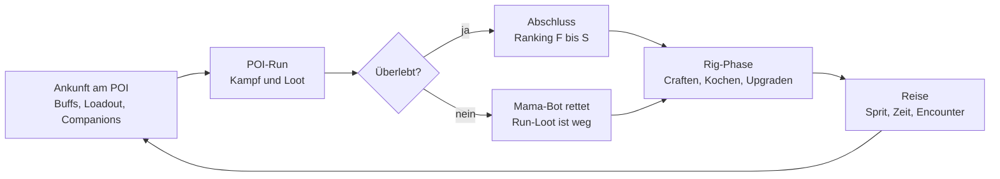

# NomadGirl – Game Design Document

Stand 07.11.2026 · Entwurf von Daniel, mit Ava überarbeitet. Die Zahlen im Spiel stehen nicht hier, sondern in der Werkstatt (`workshop.html`, Daten unter `projects/nomadgirl/data/`).

## Pitch & Setting

NomadGirl ist ein 2D-Action-Roguelite mit Cosy-Basisbau: Leyla plündert gefährliche Orte und lebt dazwischen in ihrem rollenden Zuhause, dem Rig.

- **Heldin:** Leyla, Schrottsammlerin in den Wastelands rund um BigCityDelta.
- **Rig:** Zu Beginn ein Pickup mit Wohnanhänger, später ein LKW mit gestapelten Containern.
- **Ziel:** Schrott, Ressourcen, Lebensmittel und Ausrüstung sammeln.
- **Gefahr:** Mutanten, Gegner und Dinge, über die man in BigCityDelta lieber nicht spricht.
- **Prinzip:** High Risk, High Reward. Je tiefer Leyla in einen Ort vordringt, desto besser die Beute und desto größer der mögliche Verlust.

## Core Gameplay Loop

1. **Ankunft:** Leyla erreicht einen POI mit dem Rig. Sie nutzt die Werkstätten für Buffs, stellt ihr Loadout zusammen und spricht mit Companions.
2. **POI-Run:** Leyla betritt den POI. Orte variabler Größe und Gefahr, von der Tankstelle mit NPCs bis zum verlassenen Regierungskomplex.
3. **Abschluss:** Ranking nach Durchlaufzeit, Kills und Secrets. Bei Tod rettet Mama-Bot sie, die Beute des Runs ist verloren.
4. **Rig-Phase:** Ausrüstung upgraden, craften, kochen, mit Companions reden, das Rig ausbauen.
5. **Reise:** Im Navigationssystem des Rigs die nächste Location wählen. Unterwegs können Random Encounters passieren, die sich wie kleine Level spielen.

## POI-Gameplay

Im POI spielt sich NomadGirl wie Dead Cells: schnelle Bewegung, harter Kampf, und jeder Rucksackplatz ist eine Entscheidung.

- **Aufbau:** hybrid. Handgebaute Räume werden prozedural zu einem Level zusammengesetzt (Werkstatt: „Raum-Bausteine“ und „POIs“).
- **Bewegung:** Gehen, Rennen, Springen, Schwingen, Klettern, Dashen, Sliden.
- **Kampf:** Nahkampf, Fernkampf, später optional Hacking über das Cyberdeck.
- **Inventar:** Slots für Nahkampf, Fernkampf und Cyberdeck. Dazu ein Rucksack als Raster im Diablo-Stil; Gegenstände haben Form und Größe, die Kapazität wächst mit der Qualität des Rucksacks.
- **Geld:** Deltas durch Kills, Kisten und Co.

### Tod und Mama-Bot

Stirbt Leyla, ist die Beute aus dem aktuellen Run verloren. Mama-Bot, ihre Drohne, rettet sie und bringt sie zurück zum Rig. Alles andere bleibt erhalten: Rig, Upgrades, Rezepte und Deltas auf dem Konto. Später kann Mama-Bot über Drohnen-Upgrades einen Teil der Beute mitretten.

### Ranking

Nach einem abgeschlossenen POI gibt jede Kategorie eigene Punkte, die Summe ergibt den Rang von F bis S.

| Kategorie | Misst |
| --- | --- |
| Durchlaufzeit | Wie schnell der POI geschafft wurde (gegen die Bestzeit des POI) |
| Kills | Anteil besiegter Gegner in Prozent |
| Secrets | Anteil gefundener Geheimnisse |

Das Basisgeld aus dem Run ist immer sicher. Der Rang gibt einen Deltas-Bonus obendrauf (F = kein Bonus, S = größter Bonus). Wer stirbt, schließt den POI nicht ab und bekommt kein Ranking.

## Rig & Werkstätten

Das Rig ist Leylas Zuhause, Werkstatt und Fahrzeug zugleich. Es wird im Querschnitt gezeigt wie ein Puppenhaus.

- **Zugmaschine:** Pickup zum Start, später LKW. Bestimmt Zugkraft, Spritverbrauch und wie viele Container hintereinander und übereinander passen.
- **Slots:** Motor, Panzerung, Waffen (Rig-Teile).
- **Payload:** Container (Hochseecontainer, Holzkisten, Wohnwagenteile). Anfangs knapp, mit stärkerer Zugmaschine horizontal und vertikal stapelbar. Je nach Größe fasst ein Container eine, zwei oder drei Werkstätten.
- **Budgets:** Zugkraft begrenzt das Gewicht, Energie (Lichtmaschine, Generator, Reaktor) begrenzt die Werkstätten, das Gewicht erhöht den Spritverbrauch, die Stapelhöhe kann Routen sperren.

Werkstätten: Waffenkammer, Kühlraum, Zelle, Schlafzimmer, Chill Area, Drohnenwerkstatt, Warroom, Küche, Foodtruck (jaaa, wirklich), Motorraum, Reaktor. Perspektivisch: Automatisierung der Herstellung.

## Crafting & Kochen

Rezepte: aus x A, y B (und z C) wird D, in einer bestimmten Werkstatt. Es gibt viele Gegenstände, viel Junk und viele Kombinationen, manche logisch, manche sonderbar.

Rezepte entdecken:

- **Experimentieren:** Zutaten frei kombinieren. Ein Treffer landet im Rezeptbuch, ein Fehlschlag ergibt kuriosen Müll.
- **Funde im POI:** Bauanleitungen, Kochbücher, Notizzettel.
- **Companions:** verraten Rezepte oder geben vage Hinweise.
- **NPCs:** Händler verkaufen Rezepte.

Gekochte Gerichte geben Buffs für den nächsten Run, versorgen Companions auf Reisen oder werden im Foodtruck verkauft.

## Companions, Oberwelt & Wirtschaft

- **Companions** leben im Rig: Sie betreiben Werkstätten (Koch im Foodtruck, Mechanikerin in der Drohnenwerkstatt), geben Buffs und Rezepttipps. Eigene Quests und Storylines kommen in Ausbaustufe 2. Vorerst kommen sie nicht mit in die POIs.
- **Reisen** kostet Sprit (mehr bei schwerem Rig), Vorräte (pro Kopf und Tag) und Zeit (Tag-Nacht-Wechsel, nachts gefährlicher).
- **Währung:** Deltas, die offizielle und halb wertlose Stadtwährung von BigCityDelta.
- **Foodtruck:** An POIs mit NPCs verkauft Leyla selbst gekochte Gerichte.

## Look & Feel

Weird Cyberpunk mit Augenzwinkern: humorvoll, aber niemals albern. In und um das Rig herrscht Cosy-Stimmung.

- **Perspektive:** reine Side-Scroll-Ansicht ohne Neigung.
- **Proportionen:** realistisch.
- **Rig:** Querschnitt wie ein Puppenhaus.
- **Kontrast:** draußen rau und gefährlich, drinnen warm und gemütlich.

## Technik

- **Ziel:** eine Engine, in der alle Aspekte des Spiels über die Werkstatt (GUI) gesteuert werden. Vorbild: die Werkstatt von NomadTactics.
- **Sprache:** JavaScript als ES-Module ohne Build-Schritt, wie NomadTactics. Gemeinsamer Kern (`ui.js`, `ui.css`, `basis.css`, `icons.js`, `store.js`) als Kopie.
- **Spiel:** Phaser 3 im Browser (kommt mit dem MVP, als Vendor-Datei).
- **Daten:** JSON unter `projects/nomadgirl/`, Schema in `engine/schema.js`.
- **Lizenz:** GPL v3 oder später. Alle Assets erzeugen wir selbst mit KI, nichts Externes.
- **Online:** Cloudflare Worker, https://nomadgirl.dna20717.workers.dev

## Fahrplan

### MVP: Movement & Kampf

- [ ] Gehen, Rennen, Springen
- [ ] Dash und Slide
- [ ] Klettern und Schwingen
- [ ] Ein Nahkampfangriff, ein Fernkampfangriff
- [ ] Ein Testraum mit ein bis zwei Gegnertypen
- [ ] Alle Werte kommen live aus der Werkstatt (Leyla, Waffen, Gegner)

### Ausbaustufe 1: Der Loop

Ein POI mit Ranking, Rucksack-Raster, Tod mit Mama-Bot, Rig mit zwei bis drei Werkstätten, einfache Oberweltkarte mit Sprit.

### Ausbaustufe 2

Companion-Quests und Storylines, Hacking, Automatisierung, mehr Container und Zugmaschinen.

## Offene Fragen

- [ ] Wie hoch ist der Ranking-Bonus pro Rang? (Platzhalter in der Werkstatt)
- [ ] Was macht die Zelle im Rig?
- [ ] Was ist das „vielleicht noch Gefährlichere“ in den Wastelands?
- [ ] Gibt es eine übergeordnete Story oder ein Endziel?
- [ ] Wie wird Leyla dargestellt (Pixel Art oder gezeichnet)?
