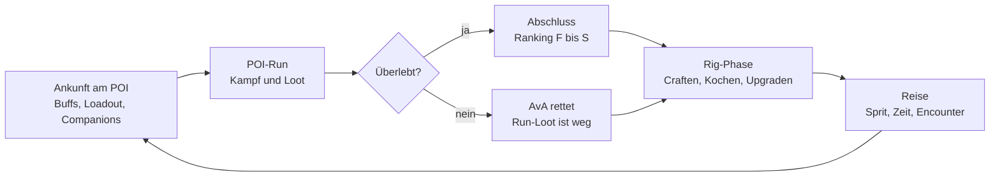

# NomadGirl – Game Design Document

Stand 07.11.2026 · Entwurf von Daniel, mit Ava überarbeitet. Die Zahlen im Spiel stehen nicht hier, sondern in der Werkstatt (`workshop.html`, Daten unter `projects/nomadgirl/data/`).

## Pitch & Setting

NomadGirl ist ein 2D-Action-Roguelite mit Cosy-Basisbau: Leyla plündert gefährliche Orte und lebt dazwischen in ihrem rollenden Zuhause, dem Rig.

- **Heldin:** Leyla, Schrottsammlerin in den Wastelands rund um BigCityDelta.
- **Rig:** Zu Beginn der Van, die ersten Werkstätten liegen verpackt bereit, später ein LKW mit gestapelten Containern. **Keine Modul-Anhänger, nur die variablen Container**; ein Container im Erdgeschoss ist zugleich Anhänger (Daniel, 12.11.2026).
- **Ziel:** Schrott, Ressourcen, Lebensmittel und Ausrüstung sammeln.
- **Gefahr:** Mutanten, Gegner und Dinge, über die man in BigCityDelta lieber nicht spricht.
- **Prinzip:** High Risk, High Reward. Je tiefer Leyla in einen Ort vordringt, desto besser die Beute und desto größer der mögliche Verlust.

## Core Gameplay Loop

1. **Ankunft:** Leyla erreicht einen POI mit dem Rig. Sie nutzt die Werkstätten für Buffs, stellt ihr Loadout zusammen und spricht mit Companions.
2. **POI-Run:** Leyla betritt den POI. Orte variabler Größe und Gefahr, von der Tankstelle mit NPCs bis zum verlassenen Regierungskomplex.
3. **Abschluss:** Ranking nach Durchlaufzeit, Kills und Secrets. Bei Tod rettet AvA sie, die Beute des Runs ist verloren.
4. **Rig-Phase:** Ausrüstung upgraden, craften, kochen, mit Companions reden, das Rig ausbauen.
5. **Reise:** Im Navigationssystem des Rigs die nächste Location wählen. Unterwegs können Random Encounters passieren, die sich wie kleine Level spielen.

## POI-Gameplay

Im POI spielt sich NomadGirl wie Dead Cells: schnelle Bewegung, harter Kampf, und jeder Rucksackplatz ist eine Entscheidung.

- **Aufbau:** hybrid. Handgebaute Räume werden prozedural zu einem Level zusammengesetzt (Werkstatt: „Raum-Bausteine“ und „POIs“). Die Räume werden **nahtlos** verschweißt wie bei Dead Cells: ein **Hauptweg** vom Eingang (mit dem Van) zum Ausgang, dazu **Abzweige** mit Beute und Secrets, die über dem Hauptweg hängen (Daniel, 10.11.2026).
- **Geheimwege, Schalter, Abkürzungen** (Daniel, 10.11.2026: „wie bei Elden Ring“): Brüchige Wände verstecken Secrets, Türen gehen nur von einer Seite per Schalter auf, und am Ende führt immer eine **Abkürzung** schnell zurück zum Van (Tunnel unter dem Level, oben eine Tür, die man von innen aufmacht).
- **Ende eines Runs:** Ziel erreichen (z. B. den Tresor knacken) = POI geschafft, die Uhr steht, der Rang ist fest. Ausgezahlt wird am Van, also erst nach dem Rückweg: k.o. auf dem Rückweg kostet trotzdem alles. Vorher zum Van = Abbruch, die Beute ist sicher, kein Ranking.
- **Bewegung:** Gehen, Rennen, Springen, Schwingen, Klettern, Dashen, Sliden.
- **Steuerung:** Tastatur oder Controller (Xbox, PlayStation, Stadia, Switch Pro; Belegung in der Werkstatt). Seit 12.11.2026 geht alles auch ohne Maus: Inventar, Kochen und Rig bauen mit Cursor (Select halten = Rig bauen, Select im Bau-Modus = Rig offen/zu). Jedes Ding im Inventar zeigt seine Aktionen (Essen/Heilen/Ausrüsten, Drohne geben, Wegwerfen; Daniel, 12.11.2026). Der rechte Stick zieht AvA sanft wie an einem Gummiband weg, ihr Scheinwerfer wird zur Tischlampe. Kanten greifen ist verzeihend (etwas über den Händen, etwas daneben, ohne Richtung nach einem Sprung). **AvA als Tritt:** mit dem rechten Stick rausgezogen (oder kurz danach geparkt) kann Leyla an ihr hochklettern und auf ihr stehen, bis der Akku leer ist (Daniel, 12.11.2026). Unten im Bild zeigt eine **Boden-Leiste** (Scan-Raster im Cyberware-Look, blendet zu den Rändern aus), was in der Nähe liegt; E / Stick ↑ hebt das erste auf, I öffnet alles.
- **Kampf:** Nahkampf, Fernkampf, später optional Hacking über das Cyberdeck.
- **Waffen mit eigenen Posen (Daniel, 12.11.2026, Test):** eine Fernkampfwaffe kann Leyla eigene Animationen mitgeben (Waffen › Posen). Erstes Beispiel: generisches Sturmgewehr (Ziehen vom Rücken, Anlegen, Schießen, Nachladen, Gehen und Rennen). Weitere Gewehre entstehen daraus, indem PixelLab in denselben Posen nur die Waffe tauscht.
- **Kampfmodus (Daniel, 11.11.2026, gebaut):** Leyla ist friedlich (Waffe weg, Idles) oder im Kampfmodus mit gezogener Waffe. Automatisch rein, wenn ein Gegner in Sicht kommt, sie getroffen wird oder abdrückt; nach ein paar ruhigen Sekunden steckt sie die Waffe weg. Dazu eine Taste (Q) zum Ziehen und Wegstecken von Hand.
- **Schießstil (Daniel, 11.11.2026, gebaut 11.11.2026 abends, Cells-like als Standard):** als Einstellung (Werkstatt › Spiel › Kampf › Schießstil, dazu Pause-Menü › Optionen) mit zwei Varianten zum Ausprobieren:
  - **Klassisch:** der heutige Stand, Leyla bleibt zum Schießen stehen.
  - **Cells-like (neu, wie Dead Cells):** Schießen im Laufen (Lauftempo dabei ~85 %). Das Spiel sucht das nächste Ziel in Blickrichtung (Kegel ±35°, Reichweite ~9 Kacheln, nur mit freier Sichtlinie); gefunden → das Projektil fliegt schräg genau dorthin, sonst gerade nach vorn. Echte, schnelle Projektile (kein Hitscan): Gegner und Wände können sie noch blocken. Optional ein Ziel-Marker am erfassten Gegner. Alle Werte in der Werkstatt (Kegel, Reichweite, Lauftempo, Kugeltempo, Marker).
  - **Geparkt:** Hybrid mit Zieltaste (Cuphead-/Metroid-Stil: halten = stehen bleiben und in 8 Richtungen bzw. frei zielen) und die Idee „Waffen bestimmen das Verhalten“ (z. B. Gewehr nur angelegt). Wieder aufgreifen, falls Cells-like nicht zündet.
  - **Gegen Dauerfeuer à la Contra:** kleines Magazin, Nachladen als verwundbarer Moment, Gegner, die Nahkampf belohnen (Schild vorn, Ausweichen, Panzerung nur per schwerem Hieb, **gebaut 12.11.2026**), Kombo-Bonus Dash/Hieb → Schuss.
- **Steuerung neu (Design-Session Daniel, 12.11.2026, gebaut 12.11.2026 vormittags):** Anlass: „Ich tue mich mit der Steuerung schwer … Inventare und Menüs haben keine einheitliche Identität in der Handhabung … schießen und Waffe ziehen ist clunky“.
  - **X = Nahkampf, Y = Fernkampf** (Tastatur J / K). **Quick Draw (1b):** Y schießt immer sofort; ist die Waffe weg, zieht Leyla sie in einer schnellen Hüftbewegung und schießt im selben Zug (~120 ms), kein eigener Zieh-Schritt mehr. **Y halten = wegstecken** (nach ~0,5 s; der Schuss vom Drücken ist schon raus). Ein Hieb mit gezogener Waffe steckt sie nicht weg. Leer abdrücken lädt nach, RB bleibt Nachladen.
  - **Kein automatisches Ziehen mehr (2b):** nur noch per Knopf; nach Ruhe steckt sie weiter von selbst weg.
  - **Benutzen (3a) auf Stick ↑** (gebaut als Neigen, Ava nach Daniels „direkt loslegen“; Vorschlag Ava: Neigen statt Drücken, nur deutlicher Ruck über ~70 %, nur im Stand/Gehen; steht ein E-Hinweis im Bild, gewinnt Benutzen vor der Leiter). Tastatur: E bleibt, ↑/W zusätzlich. L3 wird frei.
  - **Fenster pausieren immer (4)**, auch im Run (zunächst).
  - **Menüs & Inventare (5b, zunächst):** getrennte Fenster, aber eine UI-Grammatik: gleicher Rahmen (Titel + Tabs oben, Hilfezeile mit Tasten-Symbolen unten), gleiche Tasten (A/E nehmen, B/Esc eine Ebene zurück, X Kontext, LB/RB Tabs, Start Pause, Select/I Inventar), gleicher goldener Cursor mit Maus, Pfeiltasten und Stick. Ein gemeinsames Fenster mit Tabs bleibt Idee für später. Fenster-Tasten sind fest (unabhängig von der Spiel-Belegung): Pfeile/WASD bzw. Stick/Steuerkreuz wählen, E/Enter/Leertaste bzw. A nehmen, Esc bzw. B zurück, R bzw. X Kontext (drehen, raus), F bzw. Y rüber, Q bzw. LB/RB Tabs. Der Bau-Modus bleibt ein Modus (läuft weiter, Maus), hat aber Rahmen und Hilfezeile, B schließt.
- **Wände halten alles auf (Daniel, 12.11.2026, gebaut):** Hiebe, Schüsse und Gegner-Angriffe gehen nie durch Wände, geschlossene Türen oder brüchige Wände, auch wenn die Grafik hineinragt. An der Wand bleibt die Waffe an der Brust (der Schuss gibt nur Funken), bei einem Hieb rutscht Leyla ein Stück zurück, damit die Pose passt.
- **Gegner-KI (Daniel, 12.11.2026, gebaut):** aus Bausteinen, alle Werte im Bereich Gegner.
  - **Wahrnehmung:** Sicht nur mit freier Sichtlinie und im Blickwinkel (dicht dahinter spüren sie Leyla auch), **Gehör** (Schüsse tragen weit, Nahkampf kurz, durch Wände die Hälfte), Gedächtnis: verlieren sie Leyla, suchen sie an der letzten Stelle, schauen sich um und geben dann auf.
  - **Verhalten:** Patrouille (läuft, beißt), Stürmer (Sturmangriff), Schütze (hält Abstand, schießt nur mit freier Linie, die Ziellinie endet an der Wand), Lauerer (hängt an der Decke, fällt herab, kämpft dann am Boden), Flieger (schwebt über Leyla, schießt oder stößt herab), Boss vorerst wie ein Stürmer. Gegner nehmen kleine Stufen im Sprung und springen beim Verfolgen ein paar Kacheln tief.
  - **Konter:** Schild vorn (von vorn prallen Schüsse und leichte Hiebe ab, ein schwerer Treffer öffnet die Deckung, dreht sich langsam um), Ausweichen (hüpft vor Nägeln und Hieben weg), Panzerung (leichte Treffer kratzen, schwere brechen Platten). Neue Gegner: Plünderer mit Schild, Panzerwache.
  - **Offen:** eigenes Boss-Verhalten für den Hausmeister, Gruppen-Alarm (Daniel hat erst einmal Sicht + Gehör gewählt), Gegner-Grafiken.
  - **To-do: Gegnerbaukasten für Sprites** (Daniel, 12.11.2026, noch zu definieren): Gegner-Grafiken aus Bausteinen statt jeden Gegner einzeln malen. Zu klären: was ist ein Baustein (Körper, Kopf, Rüstung, Waffe, Farbe?), Ebenen im Code vs. fertige Varianten von PixelLab, welche Animationen jeder Gegner braucht, wie die Werkstatt es zeigt.
- **Inventar:** Slots für Nahkampf, Fernkampf, Cyberdeck und Rucksack. Der Rucksack ist ein Raster im Diablo-Stil; Gegenstände haben Tetris-Formen und lassen sich drehen, die Kapazität wächst mit der Qualität des Rucksacks. Bedienung nur mit der Maus, das Spiel läuft dabei weiter. Beute liegt als Bündel am Boden (Boden-Inventar wie bei XCOM); Stapelbares, das Leyla schon trägt, sammelt sie im Vorbeilaufen ein. Kisten und Lagerplätze im Rig sind ebenfalls Inventare.
- **Geld:** Deltas durch Kills, Kisten und Co.

### Tod und AvA

Stirbt Leyla, ist die Beute aus dem aktuellen Run verloren. AvA, ihre Drohne, rettet sie und bringt sie zurück zum Rig. Alles andere bleibt erhalten: Rig, Upgrades, Rezepte und Deltas auf dem Konto. Später kann AvA über Drohnen-Upgrades einen Teil der Beute mitretten. **Neu (12.11.2026):** jede Rettung kostet Zustand am Cryo-Tank, siehe „Die Suche“.

**Neu (Daniel, 12.11.2026, noch nicht gebaut), ersetzt den Absatz oben:**
- **k.o.** = Leylas Leben fällt im Run auf null. AvA schleppt sie **zum Startpunkt des Runs** (nicht ins Camp), der Wiedereinstieg ist weicher. Jede Rettung kostet Tank-Zustand.
- **Verloren ist alles, was nicht in Avas Rettungsfach (Schutzbox) liegt.**
- **Der Rucksack bleibt an der k.o.-Stelle liegen.** Leyla hat **genau eine Chance**, ihn zurückzuholen; geht sie vorher wieder k.o., ist er endgültig weg.
- **Ausrüstung am Körper bleibt** (Waffen, Rüstung, Implantate); verloren geht nur der Rucksack (2a).
- **Der Run läuft weiter.** Rang: keine Extra-Strafe, die verlorene Zeit drückt ihn ohnehin (1c).
- **Räume setzen zurück** (Gegner neu), **aber** der liegende Rucksack bleibt, und große Beute wie Tresore wird nicht zurückgesetzt (3c).
- **Ist der Tank bei einer Rettung kritisch, kostet die letzte Rettung AvA das Leben** (4c): Leyla ist gerettet, die Suche verloren.

### Ranking

Nach einem abgeschlossenen POI gibt jede Kategorie eigene Punkte, die Summe ergibt den Rang von F bis S.

| Kategorie | Misst |
| --- | --- |
| Durchlaufzeit | Wie schnell der POI geschafft wurde (gegen die Bestzeit des POI) |
| Kills | Anteil besiegter Gegner in Prozent |
| Secrets | Anteil gefundener Geheimnisse |

Das Basisgeld aus dem Run ist immer sicher. Der Rang gibt einen Deltas-Bonus obendrauf (F = kein Bonus, S = größter Bonus). Wer stirbt, schließt den POI nicht ab und bekommt kein Ranking.

## Progression, Techtree & die Suche (Design-Session Daniel, 12.11.2026, gebaut 12.11.2026 abends)

Grundsatz: Die Ziele kommen aus der Mechanik, eine Herleitung aus der Story braucht es nicht. **Das Camp ist der Spielstand, die Runs sind die Mechanik.**

### Die Suche: AvA im Cryo-Tank

- **AvA** ist eigentlich ein kleines Mädchen (Tochter? Schwester? Wir wissen es nicht). Sie ist krank, ihr Körper liegt im **Cryo-Tank**, ihr Verstand ist so lange in der Drohne geparkt.
- **Ziel:** das **Rezept für das Heilmittel** finden. Damit wird die Reise zur Suche mit Ablaufdatum.
- **Cryo-Tank** = eine Werkbank im Rig (Modell fehlt noch). Er hat einen **Zustand**, der verfällt, und braucht Wartung mit Materialien (Rezepte wie an jeder Werkbank). Er zerfällt mit der Zeit immer schneller, die nötigen Ersatzteile werden seltener: Wer das Heilmittel nicht schnell findet, muss immer mehr und gefährlichere Runs machen.
- **Die Uhr tickt pro Tag und pro Ereignis** in Ereignis-Zeit (Fahren, Schlafen, Runs …), nie in Echtzeit.
- **Rettung kostet AvA Kraft:** holt AvA Leyla beim k.o. heim, sinkt der Zustand des Tanks.
- **Stirbt AvA** (Tank kaputt), ist die Drohne für immer weg. Das Spiel endet nicht, die Suche ist aber verloren.

### Neuer Durchgang: „War alles nur ein Traum?“

- Nach Avas Tod beginnt ein **neuer Durchgang**: Leyla wacht schweißgebadet am Lagerfeuer auf. War der letzte Durchgang nur ein Traum?
- **Was bleibt (wie die Joker bei Balatro):** freigeschaltete Techtree-Knoten. **Was neu anfängt:** Rig, Inventar, Deltas, Tank und Uhr fangen klein an.
- Das Camp ist persistent: es bleibt auch nach einem Neustart, solange man es nicht ausdrücklich zurücksetzt.

### Techtree im Warroom

- Der **Warroom bleibt eine Werkbank**; seine Rezepte stellen keine Gegenstände her, sie schalten Upgrades und Stationen im Techtree frei. Die Rezeptlogik (Rezeptbuch, Zutaten, Werkstatt) wird weiterverwendet.
- Anzeige als **Techtree-Bildschirm im Warroom**.
- **Zentrale Upgrade-Ressourcen** wie bei Graveyard Keeper oder Punch Club, verdient durch Tun. Zunächst drei:
  - **Technik:** bauen, craften, Rig
  - **Wissen:** Terminals, Zettel, Secrets, guter Rang
  - **Bio:** Mutanten, Kochen, Proben (führt zum Heilmittel)
- **Erweiterbar unter der Haube:** Ressourcen kommen aus Daten (beliebig viele). Vorgesehen ist z. B. **„Dunkelheit“**: Wer den Schwierigkeitsgrad steigert, schaltet deutlich mehr der anderen Ressourcen frei (Multiplikator je Stufe). Im Spiel vorerst unsichtbar.
- Das **Heilmittel** ist der letzte Knoten: Abspann, danach offenes Spiel mit AvA als spielbarer Figur (Daniel, 12.11.2026).
- **Look (Daniel, 12.11.2026):** wie Graveyard Keeper 2: **horizontal**, Knoten mit **Bildern** von dem, was man freischaltet, Linien dazwischen; **vertikale Tabs** für die Ressourcen-Arten (Technik, Wissen, Bio; finale Namen offen). Komplett für Controller optimiert (Stick/Steuerkreuz springt von Knoten zu Knoten, LB/RB oder ↑↓ wechselt die Tabs, UI-Grammatik wie überall).
- **Erster Ast: Cryo-Tank** (Wartung, bessere Kühlung, langsamerer Verfall), damit der Druck sofort spürbar wird.

### Cryo-Tank (Daniel, 12.11.2026)

- **Tempo:** ohne Pflege stirbt AvA nach etwa **10 Runs** (umgerechnet in Ereignis-Zeit; Wert in der Werkstatt).
- **Dramatischer visueller Verfall am Tank selbst** (nicht an der ganzen Werkbank), über **mehrere Animationsphasen** hinweg (z. B. intakt → Frost-Risse → Lecks/Dampf → flackernde Anzeige/Alarm → kurz vor dem Ende). Braucht eigene Grafik (PixelLab).
- **Kann nicht verkauft werden** (auch nicht auf den Händler-Platz gezogen).
- **Steht von Anfang an im kleinsten Container.**
- **AvA leidet sichtlich** (Daniel, 3b): ist der Tank schwach, glitcht die Drohne im Run, ihr Akku schrumpft, der Scheinwerfer flackert.

### Ressourcen verdienen & Knoten (Daniel, 12.11.2026)

- **Ressourcen sind Gegenstände in der Welt (Daniel, 12.11.2026):** Technik, Wissen und Bio existieren als verwertbare Items. Man **erzeugt sie an Werkbänken** aus Beute (Vorschlag Ava: Technik an der Werkbank durch Zerlegen, Wissen im Warroom durch Auswerten von Datenträgern und Zetteln, Bio in Küche/Labor aus Proben). Sie liegen im Lager wie alles andere und werden im Warroom für Knoten ausgegeben. Damit gelten für sie dieselben Regeln wie für Beute: Was beim k.o. nicht im Rettungsfach liegt, ist weg.
- **Zerlegen (Daniel, 12.11.2026, Daten angelegt):** Jeder Gegenstand sagt, in was er sich zerlegen lässt (Gegenstände › Zerlegen: „Zerlegen an“ + „Ergibt“), andere Bauteile oder direkt Fortschritt. Neue Kategorie **Fortschritt** mit den Gegenständen **Technik ⚙, Wissen 💾, Bio 🧬** (Namen tbd). Technik meist an der Werkbank, Wissen im Warroom (Zettel, Baupläne, Datenkristall, Götzenfigur, Schallplatte), Bio in der Kochnische (Mutantenfleisch, Gemüse, Eier, Garnelen, Aufputschspritze). Grundstoffe (Schrott, Kabel, Schrauben …), Gerichte, Fehlschlag-Müll und manche Wertsachen sind nicht zerlegbar.
- **Kein Farming** („Glas bauen, um es zu zerlegen“, darf nicht gehen), von der Werkstatt geprüft: Was man herstellen kann, gibt beim Zerlegen von keinem Bestandteil mehr zurück, als im Rezept steckt, insgesamt weniger Wert, und nie Fortschritt. Fehlschlag-Müll aus Experimenten ist nicht zerlegbar. Zerlegen darf sich nicht im Kreis drehen. Die Aktion „Zerlegen“ steht seit 12.11.2026 abends (Werkbank/Kochnische: Tab „Zerlegen“, Warroom: „Auswerten“).
- Ressourcen-Rohstoffe gibt es für erledigte Aktionen: Kisten, Kills, Secrets, Kochen, Bauen; ein guter Rang gibt Wissen extra.
- **Knoten schalten frei (2c):** Rezepte, Werkstätten, Rig-Teile, Fähigkeiten für Leyla und AvA **und passive Boni** (z. B. +10 % Akku).
- Ein neuer Durchgang würfelt POI-Reihenfolge und Beute neu (Startwert Ava).
- **Tresor = Jackpot:** Im Tresor am Ende eines Runs muss **richtig viel Zeug** liegen (bislang leer). To-do.

### Der Tank-Ast (Entwurf Ava, 12.11.2026; Daniel: „Tank-Ast überlasse ich dir“)

Alle Zahlen sind Startwerte und gehören in die Werkstatt (neuer Bereich **Cryo-Tank**).

**Zustand und Verfall**
- Zustand 100 % … 0 %. Verfall je Stunde Ereignis-Zeit: `Grundrate × (1 + Beschleunigung × (100 − Zustand) / 100) × (1 + Tage im Durchgang × Alterung)`. Startwerte so, dass AvA ohne Pflege nach **~10 Runs** stirbt (ein Run samt Fahrt und Schlaf ≈ ein Tag).
- **Rettung beim k.o.:** −12 % Zustand. Liegt der Zustand bei einer Rettung unter diesem Wert, ist es **die letzte Rettung**: Leyla ist gerettet, AvA stirbt.

**Phasen (Bild am Tank + was AvA im Run spürt)**

| Phase | Zustand | Tank (Grafik, je Phase eine kleine Schleife) | AvA im Run |
| --- | --- | --- | --- |
| 1 Stabil | 100–80 % | klares Glas, ruhiges blaues Licht, Bläschen | normal |
| 2 Beschlagen | 80–60 % | Frost am Glas, Kondenswasser läuft | Gesicht stottert ab und zu |
| 3 Risse | 60–40 % | Haarrisse, Anzeige flackert gelb | Akku −15 %, Scheinwerfer flackert manchmal |
| 4 Lecks | 40–20 % | Kühlmittel tropft, Dampf, Pfütze, rotes Blinken | Akku −30 %, Bild-Glitches, verzerrte Laute |
| 5 Alarm | 20–1 % | Sirene leise, Glas fast blind, **eine kleine Hand innen am Glas** | Akku −50 %, starke Glitches, sie zittert |
| Tot | 0 % | Tank dunkel, Glas gesprungen, still | Drohne weg → „Traum“ |

**Wartung (Rezepte am Tank, wie an jeder Werkbank)**

| Wartung | Zutaten | Zustand | wirkt bis Phase |
| --- | --- | --- | --- |
| Notflicken | 2 Panzertape, 1 Schrott | +8 % | 3 (ein Leck klebt man nicht) |
| Stromzelle tauschen | 2 Batteriezellen | +12 % | 4 |
| Dichtung tauschen | 2 Stoffreste, 1 Panzertape, 2 Schrauben | +15 % | 4 |
| Kühlmittel nachfüllen | 1 **Kühlmittel** (neu) | +25 % | 5 |
| Kompressor einbauen | 1 **Kompressor** (neu, selten, tief im POI oder im Tresor) | +50 % | 5 |

Neue Gegenstände: **Kühlmittel** (Kanister; Bunker 13, Großmarkt-Kühlung, Kühlraum-Kisten) und **Kompressor** (selten). Je länger der Durchgang dauert, desto seltener werden beide in den Beutetabellen (Alterung).

**Knoten des Tank-Asts (Techtree-Tab je Ressource, Pfeile = Voraussetzung)**

| # | Knoten | Kosten | Schaltet frei | Voraussetzung |
| --- | --- | --- | --- | --- |
| 1 | Wartungsklappe | 3 Technik | Rezept „Dichtung tauschen“ | – |
| 2 | Thermohülle | 5 Technik, 1 Wissen | Bonus: Verfall −15 % | 1 |
| 3 | Lebenszeichen | 3 Wissen | Fähigkeit: Tank-Zustand als kleines Symbol im Run, Warnung beim Phasenwechsel | – |
| 4 | Notreserve | 4 Technik, 2 Bio | Bonus: Rettung kostet 25 % weniger | 1 |
| 5 | Kühlkreislauf | 8 Technik, 3 Wissen | Rezept „Kühlmittel destillieren“ (2 Mutantengemüse + 1 Batteriezelle → 1 Kühlmittel, an der Werkbank) | 2 |
| 6 | Stasis-Stabilisator | 10 Technik, 5 Wissen, 5 Bio | Bonus: Beschleunigung des Verfalls −50 %; öffnet den Bio-Ast Richtung Heilmittel | 3, 4, 5 |

Zu Beginn kennt man „Notflicken“, „Stromzelle tauschen“ und „Kühlmittel nachfüllen“. Weil Knoten einen neuen Durchgang überstehen, startet der zweite Traum schon mit Thermohülle und Co.: Das ist der Balatro-Effekt.

### Das Heilmittel (Daniel, 12.11.2026)

- Ist es fertig, wacht AvA auf, und das Spiel geht weiter. Sie wird ein **neuer spielbarer Charakter**.
- **Entschieden (Daniel, 12.11.2026, Backlog A4):** Der Heilmittel-Knoten ist das Endziel. Danach kommt ein **Abspann**, anschließend läuft das Spiel **offen** weiter, mit **AvA als spielbarer Figur**. Abspann und AvA-Steuerung sind noch zu entwerfen (Design-Session).

### Cyberware (Daniel, 13.11.2026, gebaut als #006)

- Implantate an sechs Plätzen (Augen, Nerven, Cyberarm, Herz, Beine, Haut), drei Stufen: einfach, gut und **Perk + Flaw** wie die Traits in Fallout (sehr großer Vorteil, dauerhafter Nachteil, solange eingebaut).
- **Doppelsprung und Luft-Dash schalten Implantate frei** (Beine bzw. Nerven); Leyla beginnt ohne. Der Dash am Boden geht immer.
- Hergestellt an der **Ripperdoc-Liege** (neue Werkstatt im Rig), die starken Teile nur über Baupläne aus Tresoren und von Bossen. Liste und Werte: `docs/features/cyberware.md`, Zahlen in der Werkstatt.

### Reisekarte (Daniel, 13.11.2026, gebaut als #007)

- Reisen ist eine **verwitterte Touristen-Karte der 60er** mit Marken der Spielwelt (Delta Petrol, AtomCola, Motel Salzsee …), kein Menü mehr. Am Warroom und an der Van-Tür.
- **Jeder Durchgang würfelt ein Straßennetz** um BigCityDelta: feste Wahrzeichen plus gewürfelte Orte. Leyla fährt immer eine Straße weit; weiter draußen ist es gefährlicher und lohnender, Unbekanntes bleibt „?“.
- Jedes Ziel zeigt Kosten (Strecke, Fahrzeit, Sprit, Vorräte), Gefahr und Art, und welche Beute dort vermutlich liegt. Details: `docs/features/worldmap.md`.

## Rig & Werkstätten

> **Klarstellung 12.11.2026 (Daniel):** Es gibt keine eigenen Modul-Anhänger, nur die variablen Container. Ein Container im Erdgeschoss ist gleichzeitig ein Anhänger (Rahmen, Räder, Kupplung gehören dazu). Das ist bereits so gelöst, kein To-do. **Deichselkästen gibt es nicht mehr**, Stauraum kommt aus den Lagerregalen.

Das Rig ist Leylas Zuhause, Werkstatt und Fahrzeug zugleich. Es wird im Querschnitt gezeigt wie ein Puppenhaus.

- **Zugmaschine:** Leylas Van zum Start (mit zwei eigenen Werkstatt-Plätzen: Schlafkoje und Warroom), später LKW. Bestimmt Zugkraft, Spritverbrauch und wie viele Container hintereinander und übereinander passen.
- **Slots:** Motor, Panzerung, Waffen, Dach (Rig-Teile). Rig-Teile sind Bauteile wie Werkstätten: beim Händler kaufen oder an der Werkbank aus Gegenständen herstellen, sie liegen auf dem Schrottplatz und werden beim Rig bauen an die Sockel am Van geschraubt. Die Dachbox auf dem Dach vergrößert den Kofferraum. Im Inventar zeigt der Tab der Zugmaschine, was eingebaut ist.
- **Eigener Stauraum:** Die Zugmaschine hat einen kleinen Kofferraum, damit Leyla auch ohne Lager-Werkstatt ein paar Sachen verstauen kann. Sonst lagert alles in **Lagerregalen** (Deichselkästen entfallen, 12.11.2026).
- **Payload:** Container (Hochseecontainer, Holzkisten, Wohnwagenteile). Anfangs knapp, mit stärkerer Zugmaschine horizontal und vertikal stapelbar. Je nach Größe fasst ein Container eine, zwei oder drei Werkstätten. Gestapelt wird auf Anhänger ohne Dachaufbau (und auf Container): der obere Container ist begehbar, Leyla kommt per Leiter oder Doppelsprung hoch. Die Stapelhöhe kommt von der Zugmaschine (Van 2).
- **Budgets:** Zugkraft begrenzt das Gewicht, Energie (Lichtmaschine, Generator, Reaktor) begrenzt die Werkstätten, das Gewicht erhöht den Spritverbrauch, die Stapelhöhe kann Routen sperren.

Werkstätten: Waffenkammer, Kühlraum, Zelle, Schlafzimmer, Chill Area, Drohnenwerkstatt, Warroom, Küche, Foodtruck (jaaa, wirklich), Motorraum, Reaktor. Perspektivisch: Automatisierung der Herstellung.

### Camp (Daniel, 07.11.2026 abends)

- **Ansicht:** begehbar im Side-Scroll (Leyla läuft durchs Camp und ins aufgeschnittene Rig, E benutzt Dinge). Umbauen passiert im Camp selbst (B oder Warroom › Rig umbauen), siehe „Rig bauen“.
- **Wann:** vor und nach jedem POI-Run, immer dort, wo das Rig gerade steht.
- **Zeit:** Ereignis-Zeit. Die Uhr springt nur bei Aktionen: Schlafen bis zum Morgen, am Feuer sitzen, Fahren, ein Run kostet Stunden; Kochen und Craften kosten Minuten.
- **Loop:** Im Warroom das Ziel wählen (hier plündern oder hinfahren, kostet Sprit, Vorräte, Zeit). Zurück per Van (E am Van im POI) oder Ausgang; k.o. = AvA bringt Leyla ins Camp, die Run-Beute ist weg.
- **Look:** Lagerfeuer, Tag/Nacht mit dem Wetter-System, Companions mit Sprüchen in Bläschen (zum Testen von Anfang an dabei: Schraube und Onkel Sung). Grafik erst aus Code, KI-Bilder rasten später per „Aussehen“ ein.
- **Spielstand:** online pro Login, auf allen Geräten gleich.
- **Lieferung:** 1) Camp begehbar + Werkstätten + Schlafen + Loop + Spielstand online ✔, 2) Beute + Rucksack-Raster (Tetris-Formen) ✔, 3) Kochen/Craften (Rezeptbuch + Experimentieren) ✔, 4) Bau-Ansicht (Werkstätten umstellen, kaufen, Container an-/abhängen, Budgets) ✔. Damit ist der Camp-Plan komplett (08.11.2026).

### Rig bauen (Daniel, 08.11.2026 morgens: „muss sich anfühlen wie das Bauen eines Rigs und weniger wie ein Menü“)

- **Ort:** direkt im Camp. B zoomt sanft raus auf Schrottplatz, Rig und Van, die Budget-Leiste (wie vorher) fährt oben rein; B, Esc oder „Fertig“ zoomt zurück.
- **Haptik:** Ziehen mit Gewicht. Das Teil hängt an der Maus, pendelt (schwere Teile träger), rastet mit Klonk, Staub und Wackeln ein, die Federn des Anhängers wippen nach.
- **Anhänger:** echte Silhouette: Rahmen, Achsen mit Rädern und Kotflügeln, Deichsel mit Kupplung und Stützrad, hinten eine Öse für den nächsten. Innen weiter das Puppenhaus. Daniels Bild-Anhänger bleibt, wie er ist.
- **Ankoppeln:** Anhänger packen und an eine Kupplung ziehen (hinter den Van, zwischen zwei Anhänger, ans Ende); klack.
- **Schrottplatz links beim Schacht:** ausgebaute Werkstätten auf Paletten, abgehängte Anhänger parken kleiner dahinter. Dort der **Händler-Platz**: Teil draufziehen = verkaufen, Gekauftes (Katalog über „Händler“ oder Klick aufs Schild) wird dort geliefert.
- **Sofort echt:** jede Aktion zählt gleich (Δ und Zeit). Danach läuft Leyla hin und schraubt kurz (Zeitraffer, man kann weiterbauen, sie arbeitet die Liste ab). **Rückgängig** nimmt die letzte Aktion zurück, solange Leyla sie noch nicht festgeschraubt hat.

## Crafting & Kochen

Rezepte: aus x A, y B (und z C) wird D, in einer bestimmten Werkstatt. Es gibt viele Gegenstände, viel Junk und viele Kombinationen, manche logisch, manche sonderbar.

Rezepte entdecken:

- **Experimentieren:** Zutaten frei kombinieren. Ein Treffer landet im Rezeptbuch, ein Fehlschlag ergibt kuriosen Müll.
- **Funde im POI:** Bauanleitungen, Kochbücher, Notizzettel.
- **Companions:** verraten Rezepte oder geben vage Hinweise.
- **NPCs:** Händler verkaufen Rezepte.

**Im Spiel (08.11.2026):** E an Kochnische, Küche oder Werkbank öffnet Rezeptbuch und Topf. Zutaten kommen aus Lager, Kiste und Rucksack. Experimentieren: die richtigen Zutaten in mindestens der richtigen Menge treffen (abschaltbar: genaue Mengen), ein Treffer landet im Rezeptbuch, ein Fehlschlag ergibt kuriosen Müll je Werkstatt-Art (Verkohlter Klumpen, Graue Pampe, Kabelsalat, Schrottskulptur); fehlt nur eine Zutat, heißt es „Knapp daneben“. Zettel aus dem POI liest man im Rezeptbuch, Companions im Camp geben vage Tipps und kommentieren ihre Werkstatt. Gerichte isst man im Inventar (Feld „Benutzen“). Alles einstellbar im Bereich „Kochen & Craften“.

Gekochte Gerichte geben Buffs für den nächsten Run, versorgen Companions auf Reisen oder werden im Foodtruck verkauft.

## Companions, Oberwelt & Wirtschaft

- **Companions** leben im Rig: Sie betreiben Werkstätten (Koch im Foodtruck, Mechaniker in der Drohnenwerkstatt), geben Buffs und Rezepttipps. Eigene Quests und Storylines kommen in Ausbaustufe 2. Vorerst kommen sie nicht mit in die POIs.
- **Reisen** kostet Sprit (mehr bei schwerem Rig), Vorräte (pro Kopf und Tag) und Zeit (Tag-Nacht-Wechsel, nachts gefährlicher).
- **Währung:** Deltas, die offizielle und halb wertlose Stadtwährung von BigCityDelta.
- **Foodtruck:** An POIs mit NPCs verkauft Leyla selbst gekochte Gerichte.

## Look & Feel

Weird Cyberpunk mit Augenzwinkern: humorvoll, aber niemals albern. In und um das Rig herrscht Cosy-Stimmung.

- **Perspektive:** reine Side-Scroll-Ansicht ohne Neigung.
- **Proportionen:** realistisch.
- **Rig:** Querschnitt wie ein Puppenhaus.
- **Kontrast:** draußen rau und gefährlich, drinnen warm und gemütlich.
- **Fidelity:** so hoch wie möglich. 1920×1080, Kacheln 64 px, Leyla 192 px hoch (drei Kacheln), Kamera-Zoom 0,75 (in der Werkstatt einstellbar), hochaufgelöste KI-Grafiken statt Low-Res-Pixel-Art.
- **Leyla:** pinker Irokese, ärmellose Tech-Weste, Neon-Cyan-Akzente (Details und Palette in `docs/assets.md`).

## Technik

- **Ziel:** eine Engine, in der alle Aspekte des Spiels über die Werkstatt (GUI) gesteuert werden. Vorbild: die Werkstatt von NomadTactics.
- **Sprache:** JavaScript als ES-Module ohne Build-Schritt, wie NomadTactics. Gemeinsamer Kern (`ui.js`, `ui.css`, `basis.css`, `icons.js`, `store.js`) als Kopie.
- **Spiel:** Phaser 3.90 im Browser als Vendor-Datei (`game/vendor/phaser.min.js`), Arcade-Physik. Seite `game.html`, Code in `game/play/`. (Phaser 4 ist inzwischen erschienen; ein Umstieg wäre später möglich.)
- **Daten:** JSON unter `projects/nomadgirl/`, Schema in `engine/schema.js`.
- **Lizenz:** GPL v3 oder später. Alle Assets erzeugen wir selbst mit KI, nichts Externes.
- **Online:** Cloudflare Worker, https://nomadgirl.dna20717.workers.dev

## Fahrplan

### MVP: Movement & Kampf

- [x] Gehen, Rennen, Springen (Coyote Time, Sprungpuffer, Doppelsprung, kurzer Hüpfer beim Loslassen)
- [x] Dash (auch in der Luft, unverwundbar) und Slide (unter Hindernissen durch)
- [x] Klettern (Leitern) und Schwingen (Seil-Anker, Pendel mit Schwung-Boost)
- [x] Ein Nahkampfangriff (Rohrzange), ein Fernkampfangriff (Nagelpistole)
- [x] Ein Testraum mit zwei Gegnertypen: Plünderer-Schläger (stürmt, holt aus) und Plünderer-Schütze (hält Abstand, zielt sichtbar)
- [x] Alle Werte kommen aus der Werkstatt (Leyla, Waffen, Gegner, Raum-Bausteine, Kacheln); gespeicherte Werkstatt-Stände gelten beim nächsten Laden des Spiels
- [ ] Feinschliff nach dem ersten Anspielen (Daniel)
- [x] Weitere Leyla-Animationen (Gehen, Rennen, Springen, Dash …) einklinken

**Steuerung (Tastatur):** A/D bzw. ←/→ laufen (Shift: gehen), Leertaste springen, L/C Dash, S/↓ beim Rennen Slide, S + Leertaste durch Plattform fallen, W/↑ klettern bzw. Seil greifen (auch E), J/Y Nahkampf, K/X Fernkampf, R Neustart, H Hilfe, G Hitboxen.

**Platzhalter:** Leyla hat bisher nur die Idle-Animation; Laufen, Springen, Dash, Slide, Klettern und Schwingen zeigt das Spiel mit Code-Effekten (Squash & Stretch, Neigung, Nachbilder, Blinken). Die Plünderer sind aus Code gezeichnet, bis sie ein Aussehen bekommen.

### Ausbaustufe 1: Der Loop

Ein POI mit Ranking, Rucksack-Raster, Tod mit AvA, Rig mit zwei bis drei Werkstätten, einfache Oberweltkarte mit Sprit.

- [x] Camp begehbar: Rig als Puppenhaus, Van mit Schlafkoje + Warroom, Lagerfeuer, Companions, Tag/Nacht (07.11.2026)
- [x] Loop Camp → Warroom → Run → Van/k.o. → Camp, Ereignis-Zeit, Sprit und Vorräte beim Fahren, Buffs aus dem Schlaf für den nächsten Run
- [x] Spielstand online pro Login (Cloudflare KV), ohne Worker im Browser
- [x] Beute + Rucksack-Raster (Tetris-Formen, nur Maus), Boden-Inventar im Run, Kiste und Lagerregal im Camp (07.11.2026)
- [x] Kochen & Craften (Rezeptbuch, Experimentieren, Zettel, Companion-Tipps, Essen)
- [x] Bau-Ansicht (Umstellen, Kaufen/Verkaufen, Container, Budgets Gewicht/Energie/Länge; Zugmaschine tauschen folgt)
- [x] Rig-Teile an Sockeln im Bau-Modus (kaufen, herstellen, verkaufen), Kofferraum (Deichselkästen 12.11.2026 entfallen)
- [x] Rig bauen 2.0: im Camp mit Ziehen, Pendeln, Einrasten, Schrottplatz + Händler, sofort echt, Leyla schraubt, Rückgängig
- [x] POIs aus Raum-Bausteinen zusammensetzen: Tankstelle KM7 als erstes Level mit Kisten, Secrets, Schalter-Tür, Ziel, Ranking und Abkürzung (10.11.2026); Großmarkt, Bunker, Ministerium brauchen noch Raum-Layouts

### Ausbaustufe Progression (Bauauftrag 12.11.2026)

- [x] Aufräumen: Deichselkästen raus (12.11.2026 abends) (Inhalt alter Spielstände ins Lager/die Kiste)
- [x] Tresor am Ende jedes Runs richtig voll (12.11.2026 abends: Beutetabelle „Tresor“, 6–9 Würfe + Rang-Bonus)
- [x] Zerlegen-Aktion an Werkbank, Kochnische, Warroom (12.11.2026 abends: Tab „Zerlegen“ im Kochfenster, Warroom › Auswerten)
- [x] Cryo-Tank: Werkstatt im kleinsten Container (auch in alten Spielständen), Zustand, Verfall in Ereignis-Zeit, Phasen, Wartungs-Rezepte, unverkäuflich und nicht ausbaubar, AvA leidet im Run, Bereich „Cryo-Tank“ in der Werkstatt (12.11.2026 abends)
- [x] k.o. neu (12.11.2026 abends): Startpunkt, Rucksack liegt (eine Chance), Raum-Reset außer Tresor, Ausrüstung bleibt, Rettung kostet Tank, letzte Rettung tötet AvA
- [x] Techtree (12.11.2026 abends): Bereich „Techtree“ (Knoten mit Bild, Tab/Ressource, Kosten, Voraussetzungen, Freischaltung, Position), Ressourcen-Definitionen mit versteckter „Dunkelheit“, Warroom-Bildschirm im Graveyard-Keeper-2-Look mit vertikalen Tabs, Controller zuerst; Tank-Ast als erster Inhalt
- [x] Durchgang/Traum (12.11.2026 abends): AvA tot → Leyla wacht am Feuer auf; Spielstand trennt bleibende Knoten von allem anderen; „Spiel zurücksetzen“ ausdrücklich
- [x] Grafik (PixelLab, 12.11.2026 abends): Cryo-Tank in 6 Phasen mit kleinen Schleifen, Symbole Technik/Wissen/Bio/Kühlmittel/Kompressor, Bilder der 6 Tank-Knoten

### Ausbaustufe 2

Companion-Quests und Storylines, Hacking, Automatisierung, mehr Container und Zugmaschinen.

## Offene Fragen

- [ ] Wie hoch ist der Ranking-Bonus pro Rang? (Platzhalter in der Werkstatt)
- [ ] Was macht die Zelle im Rig?
- [ ] Was ist das „vielleicht noch Gefährlichere“ in den Wastelands?
- [x] Gibt es eine übergeordnete Story oder ein Endziel? Ja: die Suche nach dem Heilmittel für AvA (12.11.2026, siehe „Progression, Techtree & die Suche“).
- [ ] Techtree: erster Ast und Knoten-Kosten stehen (Tank-Ast, Platzhalter-Werte, 12.11.2026), Heilmittel = letzter Knoten mit Abspann (12.11.2026); offen: Wie verfällt der Tank genau, welche Ersatzteile? Was ist „Dunkelheit“ im Spiel (Licht-System?)
