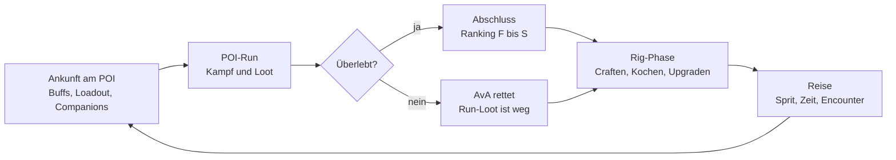
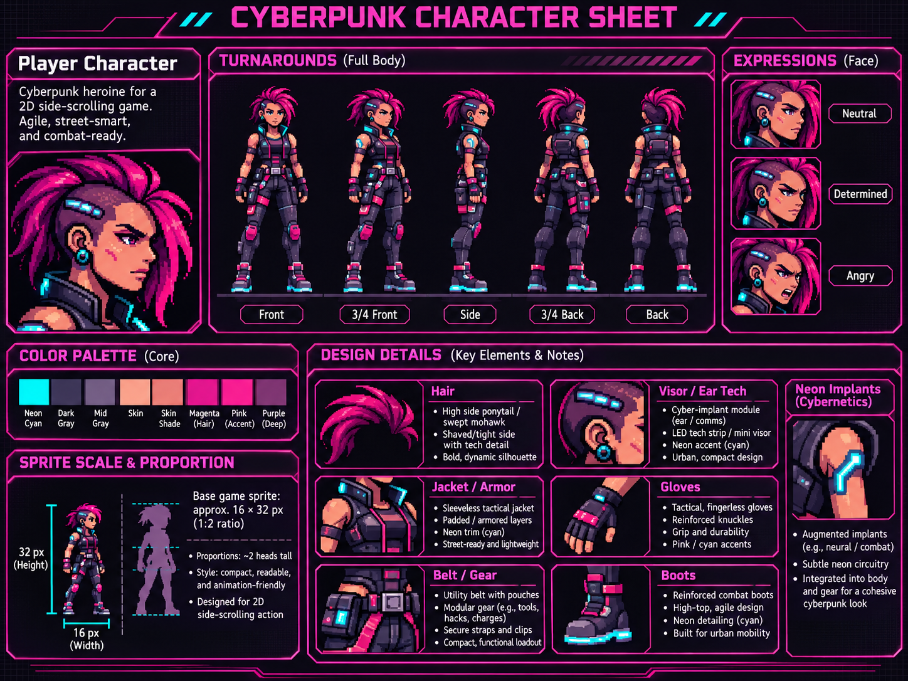

# NomadGirl – Game Design Document

Stand 07.11.2026 · Entwurf von Daniel, mit Ava überarbeitet. Die Zahlen im Spiel stehen nicht hier, sondern in der Werkstatt (`workshop.html`, Daten unter `projects/nomadgirl/data/`).

## Pitch & Setting

NomadGirl ist ein 2D-Action-Roguelite mit Cosy-Basisbau: Leyla plündert gefährliche Orte und lebt dazwischen in ihrem rollenden Zuhause, dem Rig.

- **Heldin:** Leyla, Schrottsammlerin in den Wastelands rund um BigCityDelta.
- **Rig:** Zu Beginn der Van, die ersten Werkstätten liegen verpackt bereit, später ein LKW mit gestapelten Containern. **Keine Modul-Anhänger, nur die variablen Container**; ein Container im Erdgeschoss ist zugleich Anhänger (Daniel, 12.11.2026).
- **Ziel:** Schrott, Ressourcen, Lebensmittel und Ausrüstung sammeln.
- **Gefahr:** Mutanten, Gegner und Dinge, über die man in BigCityDelta lieber nicht spricht.
- **Prinzip:** High Risk, High Reward. Je tiefer Leyla in einen Ort vordringt, desto besser die Beute und desto größer der mögliche Verlust.

## Core Gameplay Loop

1. **Ankunft:** Leyla erreicht einen POI mit dem Rig. Sie nutzt die Werkstätten für Buffs, stellt ihr Loadout zusammen und spricht mit Companions.
2. **POI-Run:** Leyla betritt den POI. Orte variabler Größe und Gefahr, von der Tankstelle mit NPCs bis zum verlassenen Regierungskomplex.
3. **Abschluss:** Ranking nach Durchlaufzeit, Kills und Secrets. Bei Tod rettet AvA sie, die Beute des Runs ist verloren.
4. **Rig-Phase:** Ausrüstung upgraden, craften, kochen, mit Companions reden, das Rig ausbauen.
5. **Reise:** Im Navigationssystem des Rigs die nächste Location wählen. Unterwegs können Random Encounters passieren, die sich wie kleine Level spielen.

## POI-Gameplay

Im POI spielt sich NomadGirl wie Dead Cells: schnelle Bewegung, harter Kampf, und jeder Rucksackplatz ist eine Entscheidung.

- **Aufbau:** hybrid. Handgebaute Räume werden prozedural zu einem Level zusammengesetzt (Werkstatt: „Raum-Bausteine“ und „POIs“). Die Räume werden **nahtlos** verschweißt wie bei Dead Cells: ein **Hauptweg** vom Eingang (mit dem Van) zum Ausgang, dazu **Abzweige** mit Beute und Secrets, die über dem Hauptweg hängen (Daniel, 10.11.2026).
- **Geheimwege, Schalter, Abkürzungen** (Daniel, 10.11.2026: „wie bei Elden Ring“): Brüchige Wände verstecken Secrets, Türen gehen nur von einer Seite per Schalter auf, und am Ende führt immer eine **Abkürzung** schnell zurück zum Van (Tunnel unter dem Level, oben eine Tür, die man von innen aufmacht).
- **Ende eines Runs:** Ziel erreichen (z. B. den Tresor knacken) = POI geschafft, die Uhr steht, der Rang ist fest. Ausgezahlt wird am Van, also erst nach dem Rückweg: k.o. auf dem Rückweg kostet trotzdem alles. Vorher zum Van = Abbruch, die Beute ist sicher, kein Ranking.
- **Bewegung:** Gehen, Rennen, Springen, Schwingen, Klettern, Dashen, Sliden.
- **Steuerung:** Tastatur oder Controller (Xbox, PlayStation, Stadia, Switch Pro; Belegung in der Werkstatt). Seit 12.11.2026 geht alles auch ohne Maus: Inventar, Kochen und Rig bauen mit Cursor (Select halten = Rig bauen, Select im Bau-Modus = Rig offen/zu). Jedes Ding im Inventar zeigt seine Aktionen (Essen/Heilen/Ausrüsten, Drohne geben, Wegwerfen; Daniel, 12.11.2026). Der rechte Stick zieht AvA sanft wie an einem Gummiband weg, ihr Scheinwerfer wird zur Tischlampe. Kanten greifen ist verzeihend (etwas über den Händen, etwas daneben, ohne Richtung nach einem Sprung). **AvA als Tritt:** mit dem rechten Stick rausgezogen (oder kurz danach geparkt) kann Leyla an ihr hochklettern und auf ihr stehen, bis der Akku leer ist (Daniel, 12.11.2026). Unten im Bild zeigt eine **Boden-Leiste** (Scan-Raster im Cyberware-Look, blendet zu den Rändern aus), was in der Nähe liegt; E / Stick ↑ hebt das erste auf, I öffnet alles.
- **Kampf:** Nahkampf, Fernkampf, später optional Hacking über das Cyberdeck (Richtung: „Hacking v3: Glitchlings“; Entwürfe v1, v2).
- **Waffen mit eigenen Posen (Daniel, 12.11.2026, Test):** eine Fernkampfwaffe kann Leyla eigene Animationen mitgeben (Waffen › Posen). Erstes Beispiel: generisches Sturmgewehr (Ziehen vom Rücken, Anlegen, Schießen, Nachladen, Gehen und Rennen). Weitere Gewehre entstehen daraus, indem PixelLab in denselben Posen nur die Waffe tauscht.
- **Kampfmodus (Daniel, 11.11.2026, gebaut):** Leyla ist friedlich (Waffe weg, Idles) oder im Kampfmodus mit gezogener Waffe. Automatisch rein, wenn ein Gegner in Sicht kommt, sie getroffen wird oder abdrückt; nach ein paar ruhigen Sekunden steckt sie die Waffe weg. Dazu eine Taste (Q) zum Ziehen und Wegstecken von Hand.
- **Schießstil (Daniel, 11.11.2026, gebaut 11.11.2026 abends, Cells-like als Standard):** als Einstellung (Werkstatt › Spiel › Kampf › Schießstil, dazu Pause-Menü › Optionen) mit zwei Varianten zum Ausprobieren:
  - **Klassisch:** der heutige Stand, Leyla bleibt zum Schießen stehen.
  - **Cells-like (neu, wie Dead Cells):** Schießen im Laufen (Lauftempo dabei ~85 %). Das Spiel sucht das nächste Ziel in Blickrichtung (Kegel ±35°, Reichweite ~9 Kacheln, nur mit freier Sichtlinie); gefunden → das Projektil fliegt schräg genau dorthin, sonst gerade nach vorn. Echte, schnelle Projektile (kein Hitscan): Gegner und Wände können sie noch blocken. Optional ein Ziel-Marker am erfassten Gegner. Alle Werte in der Werkstatt (Kegel, Reichweite, Lauftempo, Kugeltempo, Marker).
  - **Geparkt:** Hybrid mit Zieltaste (Cuphead-/Metroid-Stil: halten = stehen bleiben und in 8 Richtungen bzw. frei zielen) und die Idee „Waffen bestimmen das Verhalten“ (z. B. Gewehr nur angelegt). Wieder aufgreifen, falls Cells-like nicht zündet.
  - **Gegen Dauerfeuer à la Contra:** kleines Magazin, Nachladen als verwundbarer Moment, Gegner, die Nahkampf belohnen (Schild vorn, Ausweichen, Panzerung nur per schwerem Hieb, **gebaut 12.11.2026**), Kombo-Bonus Dash/Hieb → Schuss.
- **Steuerung neu (Design-Session Daniel, 12.11.2026, gebaut 12.11.2026 vormittags):** Anlass: „Ich tue mich mit der Steuerung schwer … Inventare und Menüs haben keine einheitliche Identität in der Handhabung … schießen und Waffe ziehen ist clunky“.
  - **X = Nahkampf, Y = Fernkampf** (Tastatur J / K). **Quick Draw (1b):** Y schießt immer sofort; ist die Waffe weg, zieht Leyla sie in einer schnellen Hüftbewegung und schießt im selben Zug (~120 ms), kein eigener Zieh-Schritt mehr. **Y halten = wegstecken** (nach ~0,5 s; der Schuss vom Drücken ist schon raus). Ein Hieb mit gezogener Waffe steckt sie nicht weg. Leer abdrücken lädt nach, RB bleibt Nachladen.
  - **Kein automatisches Ziehen mehr (2b):** nur noch per Knopf; nach Ruhe steckt sie weiter von selbst weg.
  - **Benutzen (3a) auf Stick ↑** (gebaut als Neigen, Ava nach Daniels „direkt loslegen“; Vorschlag Ava: Neigen statt Drücken, nur deutlicher Ruck über ~70 %, nur im Stand/Gehen; steht ein E-Hinweis im Bild, gewinnt Benutzen vor der Leiter). Tastatur: E bleibt, ↑/W zusätzlich. L3 wird frei.
  - **Fenster pausieren immer (4)**, auch im Run (zunächst).
  - **Menüs & Inventare (5b, zunächst):** getrennte Fenster, aber eine UI-Grammatik: gleicher Rahmen (Titel + Tabs oben, Hilfezeile mit Tasten-Symbolen unten), gleiche Tasten (A/E nehmen, B/Esc eine Ebene zurück, X Kontext, LB/RB Tabs, Start Pause, Select/I Inventar), gleicher goldener Cursor mit Maus, Pfeiltasten und Stick. Ein gemeinsames Fenster mit Tabs bleibt Idee für später. Fenster-Tasten sind fest (unabhängig von der Spiel-Belegung): Pfeile/WASD bzw. Stick/Steuerkreuz wählen, E/Enter/Leertaste bzw. A nehmen, Esc bzw. B zurück, R bzw. X Kontext (drehen, raus), F bzw. Y rüber, Q bzw. LB/RB Tabs. Der Bau-Modus bleibt ein Modus (läuft weiter, Maus), hat aber Rahmen und Hilfezeile, B schließt.
- **Wände halten alles auf (Daniel, 12.11.2026, gebaut):** Hiebe, Schüsse und Gegner-Angriffe gehen nie durch Wände, geschlossene Türen oder brüchige Wände, auch wenn die Grafik hineinragt. An der Wand bleibt die Waffe an der Brust (der Schuss gibt nur Funken), bei einem Hieb rutscht Leyla ein Stück zurück, damit die Pose passt.
- **Gegner-KI (Daniel, 12.11.2026, gebaut):** aus Bausteinen, alle Werte im Bereich Gegner.
  - **Wahrnehmung:** Sicht nur mit freier Sichtlinie und im Blickwinkel (dicht dahinter spüren sie Leyla auch), **Gehör** (Schüsse tragen weit, Nahkampf kurz, durch Wände die Hälfte), Gedächtnis: verlieren sie Leyla, suchen sie an der letzten Stelle, schauen sich um und geben dann auf.
  - **Verhalten:** Patrouille (läuft, beißt), Stürmer (Sturmangriff), Schütze (hält Abstand, schießt nur mit freier Linie, die Ziellinie endet an der Wand), Lauerer (hängt an der Decke, fällt herab, kämpft dann am Boden), Flieger (schwebt über Leyla, schießt oder stößt herab), Boss vorerst wie ein Stürmer. Gegner nehmen kleine Stufen im Sprung und springen beim Verfolgen ein paar Kacheln tief.
  - **Konter:** Schild vorn (von vorn prallen Schüsse und leichte Hiebe ab, ein schwerer Treffer öffnet die Deckung, dreht sich langsam um), Ausweichen (hüpft vor Nägeln und Hieben weg), Panzerung (leichte Treffer kratzen, schwere brechen Platten). Neue Gegner: Plünderer mit Schild, Panzerwache.
  - **Offen:** eigenes Boss-Verhalten für den Hausmeister, Gruppen-Alarm (Daniel hat erst einmal Sicht + Gehör gewählt), Gegner-Grafiken.
  - **To-do: Gegnerbaukasten für Sprites** (Daniel, 12.11.2026, noch zu definieren): Gegner-Grafiken aus Bausteinen statt jeden Gegner einzeln malen. Zu klären: was ist ein Baustein (Körper, Kopf, Rüstung, Waffe, Farbe?), Ebenen im Code vs. fertige Varianten von PixelLab, welche Animationen jeder Gegner braucht, wie die Werkstatt es zeigt.
- **Inventar:** Slots für Nahkampf, Fernkampf, Cyberdeck und Rucksack. Der Rucksack ist ein Raster im Diablo-Stil; Gegenstände belegen Rechtecke und lassen sich drehen (Daniel, 14.11.2026: „mit dem Tetris-Quatsch aufhören und auf Rechtecke beschränken“), die Kapazität wächst mit der Qualität des Rucksacks. Bedienung nur mit der Maus, das Spiel läuft dabei weiter. Beute liegt als Bündel am Boden (Boden-Inventar wie bei XCOM); Stapelbares, das Leyla schon trägt, sammelt sie im Vorbeilaufen ein. Kisten und Lagerplätze im Rig sind ebenfalls Inventare.
- **Geld:** Deltas durch Kills, Kisten und Co.

### Tod und AvA

Stirbt Leyla, ist die Beute aus dem aktuellen Run verloren. AvA, ihre Drohne, rettet sie und bringt sie zurück zum Rig. Alles andere bleibt erhalten: Rig, Upgrades, Rezepte und Deltas auf dem Konto. Später kann AvA über Drohnen-Upgrades einen Teil der Beute mitretten. **Neu (12.11.2026):** jede Rettung kostet Zustand am Cryo-Tank, siehe „Die Suche“.

**Neu (Daniel, 12.11.2026, noch nicht gebaut), ersetzt den Absatz oben:**
- **k.o.** = Leylas Leben fällt im Run auf null. AvA schleppt sie **zum Startpunkt des Runs** (nicht ins Camp), der Wiedereinstieg ist weicher. Jede Rettung kostet Tank-Zustand.
- **Verloren ist alles, was nicht in Avas Rettungsfach (Schutzbox) liegt.**
- **Der Rucksack bleibt an der k.o.-Stelle liegen.** Leyla hat **genau eine Chance**, ihn zurückzuholen; geht sie vorher wieder k.o., ist er endgültig weg.
- **Ausrüstung am Körper bleibt** (Waffen, Rüstung, Implantate); verloren geht nur der Rucksack (2a).
- **Der Run läuft weiter.** Rang: keine Extra-Strafe, die verlorene Zeit drückt ihn ohnehin (1c).
- **Räume setzen zurück** (Gegner neu), **aber** der liegende Rucksack bleibt, und große Beute wie Tresore wird nicht zurückgesetzt (3c).
- **Ist der Tank bei einer Rettung kritisch, kostet die letzte Rettung AvA das Leben** (4c): Leyla ist gerettet, die Suche verloren.

### Ranking

Nach einem abgeschlossenen POI gibt jede Kategorie eigene Punkte, die Summe ergibt den Rang von F bis S.

| Kategorie | Misst |
| --- | --- |
| Durchlaufzeit | Wie schnell der POI geschafft wurde (gegen die Bestzeit des POI) |
| Kills | Anteil besiegter Gegner in Prozent |
| Secrets | Anteil gefundener Geheimnisse |

Das Basisgeld aus dem Run ist immer sicher. Der Rang gibt einen Deltas-Bonus obendrauf (F = kein Bonus, S = größter Bonus). Wer stirbt, schließt den POI nicht ab und bekommt kein Ranking.

## Progression, Techtree & die Suche (Design-Session Daniel, 12.11.2026, gebaut 12.11.2026 abends)

Grundsatz: Die Ziele kommen aus der Mechanik, eine Herleitung aus der Story braucht es nicht. **Das Camp ist der Spielstand, die Runs sind die Mechanik.**

### Die Suche: AvA im Cryo-Tank

- **AvA** ist eigentlich ein kleines Mädchen (Tochter? Schwester? Wir wissen es nicht). Sie ist krank, ihr Körper liegt im **Cryo-Tank**, ihr Verstand ist so lange in der Drohne geparkt.
- **Woher der Tank kommt** (Daniel, 13.11.2026): Sie lag im Klinikturm von BigCityDelta auf **Ebene 40**, dem **Ersatzteillager der Elite**: Kinder im Tank, bis jemand da oben ein Organ braucht. Ihr Herz war für Donnerstag bestellt, am Mittwoch hat Leyla sie samt Tank gestohlen (Intro, Panel 1–2).
- **Ziel:** das **Rezept für das Heilmittel** finden. Damit wird die Reise zur Suche mit Ablaufdatum.
- **Cryo-Tank** = eine Werkbank im Rig (Modell fehlt noch). Er hat einen **Zustand**, der verfällt, und braucht Wartung mit Materialien (Rezepte wie an jeder Werkbank). Er zerfällt mit der Zeit immer schneller, die nötigen Ersatzteile werden seltener: Wer das Heilmittel nicht schnell findet, muss immer mehr und gefährlichere Runs machen.
- **Die Uhr tickt pro Tag und pro Ereignis** in Ereignis-Zeit (Fahren, Schlafen, Runs …), nie in Echtzeit.
- **Rettung kostet AvA Kraft:** holt AvA Leyla beim k.o. heim, sinkt der Zustand des Tanks.
- **Stirbt AvA** (Tank kaputt), ist die Drohne für immer weg. Das Spiel endet nicht, die Suche ist aber verloren.

### Neuer Durchgang: „War alles nur ein Traum?“

- Nach Avas Tod beginnt ein **neuer Durchgang**: Leyla wacht schweißgebadet am Lagerfeuer auf. War der letzte Durchgang nur ein Traum?
- **Was bleibt (wie die Joker bei Balatro):** freigeschaltete Techtree-Knoten. **Was neu anfängt:** Rig, Inventar, Deltas, Tank und Uhr fangen klein an.
- Das Camp ist persistent: es bleibt auch nach einem Neustart, solange man es nicht ausdrücklich zurücksetzt.

### Techtree im Warroom

- Der **Warroom bleibt eine Werkbank**; seine Rezepte stellen keine Gegenstände her, sie schalten Upgrades und Stationen im Techtree frei. Die Rezeptlogik (Rezeptbuch, Zutaten, Werkstatt) wird weiterverwendet.
- Anzeige als **Techtree-Bildschirm im Warroom**.
- **Zentrale Upgrade-Ressourcen** wie bei Graveyard Keeper oder Punch Club, verdient durch Tun. Zunächst drei:
  - **Technik:** bauen, craften, Rig
  - **Wissen:** Terminals, Zettel, Secrets, guter Rang
  - **Bio:** Mutanten, Kochen, Proben (führt zum Heilmittel)
- **Erweiterbar unter der Haube:** Ressourcen kommen aus Daten (beliebig viele). Vorgesehen ist z. B. **„Dunkelheit“**: Wer den Schwierigkeitsgrad steigert, schaltet deutlich mehr der anderen Ressourcen frei (Multiplikator je Stufe). Im Spiel vorerst unsichtbar.
- Das **Heilmittel** ist der letzte Knoten: Abspann, danach offenes Spiel mit AvA als spielbarer Figur (Daniel, 12.11.2026).
- **Look (Daniel, 12.11.2026):** wie Graveyard Keeper 2: **horizontal**, Knoten mit **Bildern** von dem, was man freischaltet, Linien dazwischen; **vertikale Tabs** für die Ressourcen-Arten (Technik, Wissen, Bio; finale Namen offen). Komplett für Controller optimiert (Stick/Steuerkreuz springt von Knoten zu Knoten, LB/RB oder ↑↓ wechselt die Tabs, UI-Grammatik wie überall).
- **Erster Ast: Cryo-Tank** (Wartung, bessere Kühlung, langsamerer Verfall), damit der Druck sofort spürbar wird.

### Cryo-Tank (Daniel, 12.11.2026)

- **Tempo:** ohne Pflege stirbt AvA nach etwa **10 Runs** (umgerechnet in Ereignis-Zeit; Wert in der Werkstatt).
- **Dramatischer visueller Verfall am Tank selbst** (nicht an der ganzen Werkbank), über **mehrere Animationsphasen** hinweg (z. B. intakt → Frost-Risse → Lecks/Dampf → flackernde Anzeige/Alarm → kurz vor dem Ende). Braucht eigene Grafik (PixelLab).
- **Kann nicht verkauft werden** (auch nicht auf den Händler-Platz gezogen).
- **Steht von Anfang an im kleinsten Container.**
- **AvA leidet sichtlich** (Daniel, 3b): ist der Tank schwach, glitcht die Drohne im Run, ihr Akku schrumpft, der Scheinwerfer flackert.

### Ressourcen verdienen & Knoten (Daniel, 12.11.2026)

- **Ressourcen sind Gegenstände in der Welt (Daniel, 12.11.2026):** Technik, Wissen und Bio existieren als verwertbare Items. Man **erzeugt sie an Werkbänken** aus Beute (Vorschlag Ava: Technik an der Werkbank durch Zerlegen, Wissen im Warroom durch Auswerten von Datenträgern und Zetteln, Bio in Küche/Labor aus Proben). Sie liegen im Lager wie alles andere und werden im Warroom für Knoten ausgegeben. Damit gelten für sie dieselben Regeln wie für Beute: Was beim k.o. nicht im Rettungsfach liegt, ist weg.
- **Zerlegen (Daniel, 12.11.2026, Daten angelegt):** Jeder Gegenstand sagt, in was er sich zerlegen lässt (Gegenstände › Zerlegen: „Zerlegen an“ + „Ergibt“), andere Bauteile oder direkt Fortschritt. Neue Kategorie **Fortschritt** mit den Gegenständen **Technik ⚙, Wissen 💾, Bio 🧬** (Namen tbd). Technik meist an der Werkbank, Wissen im Warroom (Zettel, Baupläne, Datenkristall, Götzenfigur, Schallplatte), Bio in der Kochnische (Mutantenfleisch, Gemüse, Eier, Garnelen, Aufputschspritze). Grundstoffe (Schrott, Kabel, Schrauben …), Gerichte, Fehlschlag-Müll und manche Wertsachen sind nicht zerlegbar.
- **Kein Farming** („Glas bauen, um es zu zerlegen“, darf nicht gehen), von der Werkstatt geprüft: Was man herstellen kann, gibt beim Zerlegen von keinem Bestandteil mehr zurück, als im Rezept steckt, insgesamt weniger Wert, und nie Fortschritt. Fehlschlag-Müll aus Experimenten ist nicht zerlegbar. Zerlegen darf sich nicht im Kreis drehen. Die Aktion „Zerlegen“ steht seit 12.11.2026 abends (Werkbank/Kochnische: Tab „Zerlegen“, Warroom: „Auswerten“).
- Ressourcen-Rohstoffe gibt es für erledigte Aktionen: Kisten, Kills, Secrets, Kochen, Bauen; ein guter Rang gibt Wissen extra.
- **Knoten schalten frei (2c):** Rezepte, Werkstätten, Rig-Teile, Fähigkeiten für Leyla und AvA **und passive Boni** (z. B. +10 % Akku).
- Ein neuer Durchgang würfelt POI-Reihenfolge und Beute neu (Startwert Ava).
- **Tresor = Jackpot:** Im Tresor am Ende eines Runs muss **richtig viel Zeug** liegen (bislang leer). To-do.

### Der Tank-Ast (Entwurf Ava, 12.11.2026; Daniel: „Tank-Ast überlasse ich dir“)

Alle Zahlen sind Startwerte und gehören in die Werkstatt (neuer Bereich **Cryo-Tank**).

**Zustand und Verfall**
- Zustand 100 % … 0 %. Verfall je Stunde Ereignis-Zeit: `Grundrate × (1 + Beschleunigung × (100 − Zustand) / 100) × (1 + Tage im Durchgang × Alterung)`. Startwerte so, dass AvA ohne Pflege nach **~10 Runs** stirbt (ein Run samt Fahrt und Schlaf ≈ ein Tag).
- **Rettung beim k.o.:** −12 % Zustand. Liegt der Zustand bei einer Rettung unter diesem Wert, ist es **die letzte Rettung**: Leyla ist gerettet, AvA stirbt.

**Phasen (Bild am Tank + was AvA im Run spürt)**

| Phase | Zustand | Tank (Grafik, je Phase eine kleine Schleife) | AvA im Run |
| --- | --- | --- | --- |
| 1 Stabil | 100–80 % | klares Glas, ruhiges blaues Licht, Bläschen | normal |
| 2 Beschlagen | 80–60 % | Frost am Glas, Kondenswasser läuft | Gesicht stottert ab und zu |
| 3 Risse | 60–40 % | Haarrisse, Anzeige flackert gelb | Akku −15 %, Scheinwerfer flackert manchmal |
| 4 Lecks | 40–20 % | Kühlmittel tropft, Dampf, Pfütze, rotes Blinken | Akku −30 %, Bild-Glitches, verzerrte Laute |
| 5 Alarm | 20–1 % | Sirene leise, Glas fast blind, **eine kleine Hand innen am Glas** | Akku −50 %, starke Glitches, sie zittert |
| Tot | 0 % | Tank dunkel, Glas gesprungen, still | Drohne weg → „Traum“ |

**Wartung (Rezepte am Tank, wie an jeder Werkbank)**

| Wartung | Zutaten | Zustand | wirkt bis Phase |
| --- | --- | --- | --- |
| Notflicken | 2 Panzertape, 1 Schrott | +8 % | 3 (ein Leck klebt man nicht) |
| Stromzelle tauschen | 2 Batteriezellen | +12 % | 4 |
| Dichtung tauschen | 2 Stoffreste, 1 Panzertape, 2 Schrauben | +15 % | 4 |
| Kühlmittel nachfüllen | 1 **Kühlmittel** (neu) | +25 % | 5 |
| Kompressor einbauen | 1 **Kompressor** (neu, selten, tief im POI oder im Tresor) | +50 % | 5 |

Neue Gegenstände: **Kühlmittel** (Kanister; Bunker 13, Großmarkt-Kühlung, Kühlraum-Kisten) und **Kompressor** (selten). Je länger der Durchgang dauert, desto seltener werden beide in den Beutetabellen (Alterung).

**Knoten des Tank-Asts (Techtree-Tab je Ressource, Pfeile = Voraussetzung)**

| # | Knoten | Kosten | Schaltet frei | Voraussetzung |
| --- | --- | --- | --- | --- |
| 1 | Wartungsklappe | 3 Technik | Rezept „Dichtung tauschen“ | – |
| 2 | Thermohülle | 5 Technik, 1 Wissen | Bonus: Verfall −15 % | 1 |
| 3 | Lebenszeichen | 3 Wissen | Fähigkeit: Tank-Zustand als kleines Symbol im Run, Warnung beim Phasenwechsel | – |
| 4 | Notreserve | 4 Technik, 2 Bio | Bonus: Rettung kostet 25 % weniger | 1 |
| 5 | Kühlkreislauf | 8 Technik, 3 Wissen | Rezept „Kühlmittel destillieren“ (2 Mutantengemüse + 1 Batteriezelle → 1 Kühlmittel, an der Werkbank) | 2 |
| 6 | Stasis-Stabilisator | 10 Technik, 5 Wissen, 5 Bio | Bonus: Beschleunigung des Verfalls −50 %; öffnet den Bio-Ast Richtung Heilmittel | 3, 4, 5 |

Zu Beginn kennt man „Notflicken“, „Stromzelle tauschen“ und „Kühlmittel nachfüllen“. Weil Knoten einen neuen Durchgang überstehen, startet der zweite Traum schon mit Thermohülle und Co.: Das ist der Balatro-Effekt.

### Das Heilmittel (Daniel, 12.11.2026)

- Ist es fertig, wacht AvA auf, und das Spiel geht weiter. Sie wird ein **neuer spielbarer Charakter**.
- **Entschieden (Daniel, 12.11.2026, Backlog A4):** Der Heilmittel-Knoten ist das Endziel. Danach kommt ein **Abspann**, anschließend läuft das Spiel **offen** weiter, mit **AvA als spielbarer Figur**. Abspann und AvA-Steuerung sind noch zu entwerfen (Design-Session).

### Cyberware (Daniel, 13.11.2026, gebaut als #006)

- Implantate an sechs Plätzen (Augen, Nerven, Cyberarm, Herz, Beine, Haut), drei Stufen: einfach, gut und **Perk + Flaw** wie die Traits in Fallout (sehr großer Vorteil, dauerhafter Nachteil, solange eingebaut).
- **Doppelsprung und Luft-Dash schalten Implantate frei** (Beine bzw. Nerven); Leyla beginnt ohne. Der Dash am Boden geht immer.
- Hergestellt an der **Ripperdoc-Liege** (neue Werkstatt im Rig), die starken Teile nur über Baupläne aus Tresoren und von Bossen. Liste und Werte: `docs/features/cyberware.md`, Zahlen in der Werkstatt.

### Reisekarte (Daniel, 13.11.2026, gebaut als #007)

- Reisen ist eine **verwitterte Touristen-Karte der 60er** mit Marken der Spielwelt (Delta Petrol, AtomCola, Motel Salzsee …), kein Menü mehr. Am Warroom und an der Van-Tür.
- **Jeder Durchgang würfelt ein Straßennetz** um BigCityDelta: feste Wahrzeichen plus gewürfelte Orte. Leyla fährt immer eine Straße weit; weiter draußen ist es gefährlicher und lohnender, Unbekanntes bleibt „?“.
- Jedes Ziel zeigt Kosten (Strecke, Fahrzeit, Sprit, Vorräte), Gefahr und Art, und welche Beute dort vermutlich liegt. Details: `docs/features/worldmap.md`.

### Achievements & Trophäen (Design-Session Daniel, 13.11.2026)

Daniel: „Wir benutzen den Trophäenraum, um Achievements zu visualisieren. Ein Achievement erzeugt immer ein Rezept mit Bezug zum Achievement, das man einmalig an einer Werkbank herstellen kann. Wenn man das Belohnungs-Item hergestellt und im Trophäenraum ausgestellt hat, bekommt man einen permanenten Bonus“ (Vorbild: Badass-Ränge in Borderlands 2).

- **Ablauf:** Achievement erreicht → Meldung „🏆 *Name*“ → gleich danach „📜 Rezept gelernt: *Trophäe*“ → an der Werkbank **einmalig** herstellen (Zutaten gern aus dem Zerlegen, damit Material sinnvoll abfließt) → auf einen Trophäen-Ständer in einer Schatzkammer stellen → Holo-Schild leuchtet, **Bonus aktiv**.
- **Jede ausgestellte Trophäe wirkt** (1a), ohne Obergrenze. Die Grenze ist der Platz: Reichen die Ständer nicht, baut man **weitere Trophäenräume** (Schatzkammern) ins Rig, mit Strom, Gewicht und Containerplatz als natürlichem Preis. Der Bonus zählt, solange die Trophäe auf irgendeinem Ständer im Rig steht.
- **Boni gemischt** (3c): kleine Prozentwerte (z. B. +5 % Krit Revolver) und Spezialeffekte mit Bezug zum Achievement (z. B. Goldene Gießkanne: Hydrokultur wächst schneller).
- **Neuer Durchgang** (2a): Achievements, ihre Rezepte und hergestellte Trophäen **bleiben als Erinnerungsstücke** erhalten, wie die Techtree-Knoten. ⚠️ vorläufig (Ava): Nach dem Aufwachen liegen sie in einer Erinnerungskiste am Feuer und wirken erst wieder, wenn sie ausgestellt sind.
- ⚠️ vorläufig (Ava): Achievement-Trophäen sind unverkäuflich und nicht zerlegbar, sonst wäre der Bonus für immer weg.
- **Arten:** Kampf, Erkundung (Secrets, POIs), Cosy (Hydrokultur, Kochen, Rig), AvA/Tank, Story; dazu **versteckte** Achievements. Beispiele (Ava): 100 Kopfschüsse mit dem Revolver → Messing-Patrone (+Krit Revolver); alle Secrets im Bunker 13 → Bunker-Schlüsselbund (Secrets leichter sichtbar); 50 Ernten → Goldene Gießkanne; 10 Runs ohne kritischen Tank → AvAs erstes Bild (Tank verfällt langsamer).
- **Werkstatt:** eigener Bereich „Achievements“: Name, Text, versteckt, Bedingung (Zähler + Zielwert oder Ereignis), Rezept (Zutaten, Werkstatt-Art), Trophäe (Gegenstand mit Tag Trophäe, Symbol, Rastergröße), Bonus (Wert + Prozent oder Spezialeffekt).
- **Gebaut** als #012 (13.11.2026): 12 Achievements, Zähler, Boni, Holo-Schild, Erinnerungskiste, Übersicht im Pause-Menü; Details `docs/features/achievements.md`.
- **Idee für später** (nicht entschieden): Ruhm-Punkte je ausgestellter Trophäe, ab Schwellen Titel für Leyla („Wastelandkind“, „Legende von BigCityDelta“), wie die Badass-Ränge.

## Rig & Werkstätten

> **Klarstellung 12.11.2026 (Daniel):** Es gibt keine eigenen Modul-Anhänger, nur die variablen Container. Ein Container im Erdgeschoss ist gleichzeitig ein Anhänger (Rahmen, Räder, Kupplung gehören dazu). Das ist bereits so gelöst, kein To-do. **Deichselkästen gibt es nicht mehr**, Stauraum kommt aus den Lagerregalen.

Das Rig ist Leylas Zuhause, Werkstatt und Fahrzeug zugleich. Es wird im Querschnitt gezeigt wie ein Puppenhaus.

- **Zugmaschine:** Leylas Van zum Start (mit zwei eigenen Werkstatt-Plätzen: Schlafkoje und Warroom), später LKW. Bestimmt Zugkraft, Spritverbrauch und wie viele Container hintereinander und übereinander passen.
- **Slots:** Motor, Panzerung, Waffen, Dach (Rig-Teile). Rig-Teile sind Bauteile wie Werkstätten: beim Händler kaufen oder an der Werkbank aus Gegenständen herstellen, sie liegen auf dem Schrottplatz und werden beim Rig bauen an die Sockel am Van geschraubt. Die Dachbox auf dem Dach vergrößert den Kofferraum. Im Inventar zeigt der Tab der Zugmaschine, was eingebaut ist.
- **Eigener Stauraum:** Die Zugmaschine hat einen kleinen Kofferraum, damit Leyla auch ohne Lager-Werkstatt ein paar Sachen verstauen kann. Sonst lagert alles in **Lagerregalen** (Deichselkästen entfallen, 12.11.2026).
- **Payload:** Container (Hochseecontainer, Holzkisten, Wohnwagenteile). Anfangs knapp, mit stärkerer Zugmaschine horizontal und vertikal stapelbar. Je nach Größe fasst ein Container eine, zwei oder drei Werkstätten. Gestapelt wird auf Anhänger ohne Dachaufbau (und auf Container): der obere Container ist begehbar, Leyla kommt per Leiter oder Doppelsprung hoch. Die Stapelhöhe kommt von der Zugmaschine (Van 2).
- **Budgets:** Zugkraft begrenzt das Gewicht, Energie (Lichtmaschine, Generator, Reaktor) begrenzt die Werkstätten, das Gewicht erhöht den Spritverbrauch, die Stapelhöhe kann Routen sperren.

Werkstätten: Waffenkammer, Kühlraum, Zelle, Schlafzimmer, Chill Area, Drohnenwerkstatt, Warroom, Küche, Foodtruck (jaaa, wirklich), Motorraum, Reaktor. Perspektivisch: Automatisierung der Herstellung.

### Ausrüstung wirkt auf die Reise (Design-Session 14.11.2026)

Daniel: „Ausrüstung des Rigs hat Auswirkungen auf Reisen und beeinflusst Chancen, dass Dinge passieren. Geschütz auf max macht Überfälle unmöglich, Scheinwerfer ermöglicht mehr Speed bei Nacht usw.“ Stand heute: Panzerung und Schaden der Rig-Teile werden nur angezeigt und wirken nirgends.

- **Keine eigene Werkstatt fürs Tuning:** Rig-Teile werden wie bisher im Bau-Modus an die Sockel geschraubt.
- **Chancen statt fester Ereignisse:** Jeder Zwischenfall hat eine Grundchance, die Werte des Rigs schieben sie hoch oder runter. Beispiele: Geschütz/Bewaffnung = Überfälle seltener, ab einer **Schwelle unmöglich** (Daniel: die Summe der Bewaffnung zählt, Qualität hilft, die Schwelle schneller zu erreichen; z. B. zwei Geschütze am LKW); Scheinwerfer = nachts fast volles Tempo, weniger Ghule. ⚠️ vorläufig (Ava): Rammbügel/Bleche = Straßensperre ohne Schaden durchbrechen; Offroad-Reifen = weniger Pannen und Sandsturm, auf der Straße etwas langsamer; V8 = Zugkraft und Tempo, säuft, **laut** (lockt Überfälle an); Radarschüssel = Vorwarnung, dann „Umfahren“; Zusatztank = Reichweite. Neue Werte also Tempo, Reichweite, Gelände, Licht, Lärm, Bewaffnung.
- ⚠️ vorläufig (Ava): Zwischenfälle bekommen Optionen mit Bedingung (Feld `requires`, z. B. „Rammen“ ab Panzerung 20). Die Karte zeigt vor dem Losfahren das Risiko je Route mit Gründen („Überfall ●○○ · Geschütz −60 %“). Alle Werte in der Werkstatt.

### Bergungsprojekt: der LKW (Design-Session 14.11.2026)

Daniel: „Bergungsprojekt ist eine gute Idee … Eine Werkstatt wird es aber nicht geben. Das Wrack taucht am Ende des Camps an der Location auf, wo es gefunden wurde, und hier kommt der Clou: Man muss mehrmals zurückgehen, bis er fertig ist.“

- **Quest ab Spielstart**, weil der Van zu schwach ist: Er zieht nur das Start-Rig, **jeder weitere Container braucht den LKW** (früh).
- **Ort gewürfelt je Durchgang** (in Startnähe), auf der Karte markiert. Camp an diesem Ort = das Wrack steht am Ende des Camps; E daran zeigt die Bergungsliste.
- **Mehrere Besuche, weil die Teile nur woanders liegen:** Die Bauabschnitte brauchen Teile aus anderen Orten. Leyla plündert dort und fährt zurück, um sie einzubauen. ⚠️ vorläufig (Ava): Abschnitte Freilegen → Fahrwerk (Reifen, Achse) → Motor (Motorblock, Kabelbaum, Batterie) → Kabine & Tank (Bleche, Diesel) → Probestart (Drehzahl-Moment, gut = besserer Motor, nie Scheitern); Fortschritt sichtbar am Wrack; Questlog listet fehlende Teile und wahrscheinliche Fundorte; Projekte als Daten (Werkstatt › Bergungsprojekte), damit später weitere Bergungen gehen.
- **Keine Gefahr fürs Wrack** (gemütlich): Was eingebaut ist, bleibt.
- **Gebaut** als #023 (15.11.2026): Bergungsprojekte LKW, Crawler, Fatbird mit Teilen aus POIs, Questlog und Karte; Details `docs/features/megarigs.md` › Bergungsprojekte.
- **Der Wrack-Ort wird die Basis:** Ist der LKW fertig, **bleibt der Van dort stehen**. Erstmal nur das; mit etwas Ausblick: Hier kann später eine Siedlung entstehen (passt zum Konzept Kundenabend im Projekt-Doc `claude/konzept-kundenabend.md`).
- **Neuer Durchgang: der LKW bleibt.** ⚠️ offen: Steht der Van im neuen Durchgang trotzdem irgendwo als Basis?

### Endgame-Zugmaschinen: Crawler und Fatbird (Design-Session 14.11.2026)

Daniel: In einem extrem guten ersten oder spätestens im zweiten Durchgang soll man einen Crawler (wie der Raupentransporter der NASA für Raketen) oder einen Cargo-Lifter freischalten können. „Riesenpanzer hat den Vorteil, beinahe unendlich viele Container einbauen und vor allem aufbauen zu können, während der Lifter zwar ein ultra großzügiges Angebot für Werkstätten hat, aber wenn voll, dann voll. Dafür ist er super schnell und kann indirekt reisen.“

- **Zwei Endgame-Fahrzeuge:** **Crawler** = der Riesenpanzer; **Fatbird** = das schwebende Lastluftschiff (zuerst „Schwerlast-Drohne“ genannt, Look siehe unten) (Name oder später eine Marke der Spielwelt; „CargoLifter“ war eine echte Firma, deshalb ein eigener Name).
- **Crawler:** fast unbegrenzt Container, in die Breite und vor allem in die Höhe aufbauen. Schwächen: **langsam**, **kommt nicht überall hin** (Routen gesperrt) und **braucht eine Crew**, die essen, trinken und Spaß braucht. Gepanzert: Die Bewaffnungs-Schwelle gegen Überfälle ist leicht erreicht. **Dafür hat er eine Ladebucht für Van oder LKW** (Daniel). ⚠️ vorläufig (Ava): Damit fährt Leyla mit Van/LKW (und dem, was dranhängt) zu Orten, an die der Crawler nicht hinkommt, der Crawler wartet als rollende Basis; der Van, der nach der LKW-Bergung an der Basis stand, kann so wieder mitkommen.
- **Fatbird:** sehr viele Werkstatt-Plätze in fester Form, kein Aufbauen, voll ist voll. **Super schnell** und **reist indirekt**: Luftlinie über die Karte, ohne Straßen. ⚠️ vorläufig (Ava): Zwischenfälle in der Luft (Wind, Sandsturm, Drohnen) statt Straßensperren; im Camp schwebt er über dem Platz, die Gondel bleibt ein Puppenhaus, Leyla klettert per Leiter hoch.
- **Freischalten als Ausbaustufe** mit Rückbezug auf das erste Bergungsprojekt (LKW): wieder eine Bergung über mehrere Abschnitte, aber viel größer. Beide sind der **Lategame-Geldfresser**: Sie verschlingen **Ressourcen, Gegenstände und NPCs**, denn **man braucht eine Crew**.
- **In jedem Durchgang möglich, im ersten sehr schwer.**
- **Beide zu haben ist das ultimative Ziel** mit eigenem Achievement, „was für die 1 %“.
- **Crew = eigenes Sozialsystem** (Daniel, 14.11.2026 abends: „nicht auf Kunden beziehen, sondern ein Sozialsystem bauen, damit wir nicht in Features denken, sondern in Systemen“). Ausgearbeitet in „Die Karawane: Sozialsystem“ (Design-Session 16.11.2026).
- **Mega-Rigs aus Kachel-Sets statt aus einem Bild** (Daniel, 14.11.2026 spätabends: „dass die Mega-Rigs eher aus mehreren Tilesets zusammengesetzt werden, anstatt im Ganzen erzeugt zu werden“). Crawler und Fatbird entstehen aus wiederholbaren Bausteinen wie die POI-Kacheln (TileSet00) und das Fahrgestell des Rigs. **Nur das rohe Fahrzeug ist spezifisch, alles andere ist ein gemeinsamer Baukasten** (Daniel, 14.11.2026 23:42: „bis auf die rohen Fahrzeuge (gerne größere Tiles) alles so modular, dass es auch für das andere Fahrzeug genutzt werden kann“):
  - **Rohes Fahrzeug = eigenes Kachel-Set je Fahrzeug, gern mit größeren Kacheln** (Daniel: „damit die Fahrzeuge wie Fahrzeuge aussehen“): Crawler = Kettenfahrwerke, Plattform, Kabine; Fatbird = Rumpf, Cockpit, Rahmen, Rotoren, Gashülle. Die Segmente sind als Teile genau dieses Fahrzeugs gezeichnet (durchgehende Linie, Nieten, Lackkanten, Anschlussstellen) und fügen sich nahtlos zusammen.
  - **Alles darauf ist ein gemeinsamer Baukasten für beide Fahrzeuge** (und ⚠️ wo sinnvoll fürs Rig): Container-Module, Aufbauten, Geschütztürme, Kran, Antennen, Schüssel, Bohrturm, Balkone, Treppen, Banner, Neon-Schilder, Sonnensegel. Dafür einheitliches Raster und einheitliche Anschlusspunkte auf beiden Fahrzeugen.
  - **Im Inneren lassen sich Räume platzieren, die genauso funktionieren wie die Container** (Daniel): gleiches System wie Container (Werkstätten, Lager, Budgets für Gewicht, Strom, Plätze, Bau-Modus), nur im Rumpf/in der Hülle bzw. in der Plattform statt außen. **Den Innenraum teilt man selbst auf:** Räume gibt es wie die Container in den Größen **1, 2 oder 3** (Daniel, 23:46: „dass man durch Räume den Innenteil selbst aufteilen kann, 1, 2 oder 3 wie die Container“); der Innenraum ist eine freie Fläche, die man mit Räumen und Trennwänden in Abschnitte gliedert. Räume teilen sich den Katalog mit den Containern, ein Raum ist ein Container ohne Außenhaut (Daniel: „genau so“). ⚠️ vorläufig (Ava): Crawler = Raupen-Segmente (Anfang, Mitte wiederholbar, Ende), Plattform-Segmente, Stützen/Treppen für die Etagen, Kommandobrücke, Bohrturm; Fatbird = Gondel-Segmente (Bug, Mitte wiederholbar, Heck), Rotor-/Triebwerks-Gondeln, Ladeluke, Leiter. Die Länge wächst mit dem Ausbau (mehr Segmente = mehr Plätze), Bauteile der Äste hängen sichtbar dran (Geschütztürme bei Dreadnought/Bomber, Bohrturm bei Factory, Antennen bei Scout …), Lack/Farbtausch aus Code. Vorteil: weniger PixelLab, jede Größe möglich, Zustände der Bergung (Wrack → fertig) je Segment. Das gilt ⚠️ auch für das LKW-Wrack, falls es sich anbietet. Assets dadurch eher ~40–80 PixelLab-Generierungen für beide Sets statt 100–150 (frühestens nach dem Reset am 07.12., nur mit Daniels Freigabe).
- **Prototyp gebaut** (#022, 14.11.2026, Daniel per Multiple Choice): **Platz-Raster** wie die Container, **LKW aus dem vorhandenen PixelLab-Bild, Teile andocken** (sein Teileblatt wird gemeinsamer Baukasten), Daten in der Werkstatt (Mega-Rigs, Anbauteile), **begehbar mit Leyla** unter `/megarig` (nicht im Menü, nicht im Spiel). Details `docs/features/megarigs.md`.
- **Fatbird: Look und Leben an Bord** (Daniel, 14.11.2026 spätabends, mit Referenzbild eines Lastluftschiffs): ein **Lastluftschiff** in diesem Stil, aber mehr Cyberpunk. Prall gefüllte, silberne Hülle, darunter ein offener **Lastrahmen** aus Stahlträgern, seitliche Mantelpropeller/Triebwerke, Container hängen an Seilen. ⚠️ vorläufig (Ava): Cyberpunk = Neon-Leisten und Positionslichter, Holo-Werbung oder Marken-Logos auf der Hülle, Flicken, Rost, Kabel; das rote Kreuz des Referenzbilds nicht übernehmen (geschütztes Zeichen), statt dessen eigene Markierung. Das Referenzbild kommt nicht ins Repo (Herkunft unbekannt), es dient nur als Beschreibung.
- **Konzeptbilder** (Daniel, 14.11.2026 23:36, im Repo als Referenz-Assets `concept_fatbird` und `concept_crawler`, `assets/vehicles/concept/`). Gemeinsamer Look: Pixel-Art, Gelb mit Rost und Warnstreifen, dunkles Violett, Neon-Blau/-Pink, rote Positionslichter, ein Dreiecks-Logo als Markenzeichen.
  - **Fatbird = Mischung** (Daniel): Rumpf, Cockpit, Container-Rahmen und **vier Mantelrotoren** wie im Konzeptbild (schwere Lastdrohne, blaue Schwebe-Düsen unten), **darüber zusätzlich eine Gashülle** wie beim Lastluftschiff. ⚠️ vorläufig (Ava): Die Gashülle trägt, die Rotoren steuern und schieben; Container sitzen im Rahmen (= „in der Hülle“) und hängen darunter.
  - **Crawler** wie im Konzeptbild: lange Raupenplattform mit zwei Kettenfahrwerken, gelbe Kabine vorn, darauf eine **gestapelte Container-Stadt** (Fenster, Neon-Schilder, Banner, Sonnensegel, Balkone, Kran hinten, Satellitenschüssel, Bohrturm/Antennen). Größenvergleich im Bild: Mensch, Auto, Panzer winzig daneben. Passt zu Homestead/Factory/Dreadnought: die Stadt wächst sichtbar nach oben.
- **Container-Module unter der Hülle und in der Hülle** (Daniel): zwei Bauzonen, der Lastrahmen unten und Decks im Inneren der Hülle.
- **Der Fatbird schwebt permanent, Leyla bleibt an Bord** (Daniel). Runter zu den POIs geht es per **Seilwinde/Lastaufzug** (Plattform wird abgelassen, wie die Container im Bild).
- **Camp: beides** (Daniel): ein Camp **an Bord** (Feuerstelle/Lounge auf einem Deck, Blick über die Wolken) und ein Camp **unten am Seil** (abends wird eine Plattform mit Feuer abgelassen). ⚠️ offen: Wann welches (wählbar, Wetter, Gefahr am Ort)?
- **Beide Fahrzeuge sind kleine Parkour-Level für Leyla** (Daniel, 14.11.2026 23:48: „Es muss Spaß machen, sie zu erkunden“). ⚠️ vorläufig (Ava): Die Wege entstehen aus dem Baukasten selbst: Jedes Modul bringt Kanten, Leitern, Durchgänge, Dachflächen und Anschlüsse für Seile mit, also nutzt Leyla ihre ganze Bewegung (Kanten, Leiter, Seil, Dash, Slide, Salto). Dazu eigene Verbindungs-Module (Treppen, Seilrutschen zwischen Türmen, Lüftungsschächte, Laufstege, Netze). Fahrzeug-typisch: Crawler mit kletterbarem Kran, Bohrturm, Bannern und Balkonen der Container-Stadt; Fatbird mit Rotor-Auslegern, Rahmenträgern, Laufstegen um die Gashülle und der Seilwinde. Belohnungen fürs Erkunden: Aussichtspunkte ganz oben, versteckte Ecken mit Notizen/Secrets, Crew-Szenen, Achievements. Der Bau-Modus prüft die **Erreichbarkeit** (kein Raum ohne Weg dorthin).
- ⚠️ offen: Braucht der Fatbird auch eine Crew? Was passiert mit dem LKW, wenn ein Endgame-Fahrzeug fertig ist (zweite Basis?)?

### Fahrzeug-Skilltrees und Heavy-Duty-Werkbank (Design-Session 14.11.2026)

Daniel: „Es sind so mächtige Mechaniken, dass reines Upgraden nicht genug ist. Ich sehe sie wirklich eher jeweils als eigenen Techtree bzw. Skilltree.“

- **Je Fahrzeug ein eigener Skilltree: Rig (Van/LKW), Crawler, Fatbird.** Rig-Teile bleiben Ausrüstung (tauschbar, im Bau-Modus), der Baum ist die Identität (dauerhaft): Er bestimmt, *was* das Fahrzeug kann, die Teile, *wie gut*.
- **Skillpunkte durch Fahren + Ressourcen:** Punkte gibt es für Kilometer, Etappen und überstandene Zwischenfälle; Knoten kosten zusätzlich Ressourcen (Geldfresser).
- **Äste schließen sich aus** (echte Spezialisierung). **Umskillen geht, ist aber teuer** (an der Heavy-Duty-Werkbank, viele Ressourcen).
- **Die Bäume bleiben über den Durchgang** (wie Techtree-Knoten und LKW).
- **Heavy-Duty-Werkbank** (neue Werkstatt): Hier sieht und skillt man die Fahrzeug-Bäume. Sie kann **nur Fahrzeug-Sachen** (Bäume, Umskillen, Rig-Teile herstellen); im Lategame ersetzt sie per Ausbau die reguläre Werkbank. Das Anschrauben der Teile bleibt im Bau-Modus.
- **Drei Äste je Fahrzeug für verschiedene Spielstile** (Daniel, 14.11.2026 abends). Alle Fahrzeuge folgen demselben **Raster aus drei Spielstilen**: ⚔️ Kampf (sucht Ärger, Beute mit Gewalt) · 🧭 Erkundung (sieht mehr, schneller, findet Verstecktes) · 🏠 Aufbau (Heimat, Herstellung, Gemeinschaft). Das Raster ist ein **internes Design-Werkzeug**; im Spiel erscheint es nur als Symbol ⚔️🧭🏠 am Ast. Man kombiniert frei über die Fahrzeuge (z. B. Bastion-Rig + Homestead-Crawler + Scout-Fatbird).
- **Namensregel: alle Äste englisch** (Daniel: „wir werfen zu viele Logiken durcheinander in punkto Namen“). Gilt als Ausnahme zu „Oberflächen deutsch“, wie bei Fatbird.

| Fahrzeug | ⚔️ Kampf | 🧭 Erkundung | 🏠 Aufbau |
|---|---|---|---|
| Rig (Van/LKW) | **Bastion** | **Roamer** | **Haven** |
| Crawler | **Dreadnought** | **Factory** | **Homestead** |
| Fatbird | **Bomber** | **Scout** | **Carrier** |

- **Rig** (abgesegnet, Inhalt und Keystones): **Bastion** = Panzerung, Rammen, Geschütz-Sockel, die Schwelle gegen Überfälle sinkt; Keystone **„Kriegspfad“**: Überfälle werden zu kurzen Gefechten mit Extra-Beute. **Roamer** = Tempo, Reichweite, Nachtfahrt, Radar, Gelände, Schotterpisten als Abkürzung; Keystone **„Ortskundig“**: jede Fahrt deckt die Nachbarorte auf, Zwischenfälle selbst wählen. **Haven** = Werkstatt-Plätze, Strom, Stapelhöhe, Buffs halten länger; Keystone **„Zuhause ist, wo der Van steht“**: Kochen, Schlafen, Herstellen auch zwischen zwei Etappen.
- **Crawler:** **Dreadnought** = Geschütztürme, Abschreckung, wo er parkt, sinkt die Gefahr; ⚠️ Keystone „Belagerung“: beschießt einen POI vorher, der Run startet mit deutlich weniger Gegnern. **Factory** = **Bohren + Automatisierung** (Daniel): fördert Rohstoffe am Lagerplatz und verarbeitet sie selbst; ⚠️ Keystone „Schacht“: bohrt sich nach unten und öffnet unter jedem Ort einen **Untergrund-POI** (der Schacht im Camp bekommt eine Aufgabe). **Homestead** = Bauhöhe, Bewohner, Crew-Plätze, Stimmung, Andockpunkt fürs Sozialsystem; ⚠️ Keystone „Rollende Stadt“: das Camp ist überall, die Bewohner arbeiten, während Leyla im Run ist.
- **Fatbird:** **Bomber** = Versorgungsabwurf im Run, Luftschlag, Bergung bei k.o. (ein Teil der Beute bleibt); ⚠️ Keystone „Absprung“: der Run beginnt von oben. **Scout** = Karte aufdecken, Wetter vorhersagen, POIs von oben auskundschaften; ⚠️ Keystone „Allsehend“: vor jedem Run den Plan des POI sehen (Secrets, Tresor, Abkürzung). **Carrier** = Traglast, Plätze, Lieferflüge zwischen Orten; ⚠️ Keystone „Luftbrücke“: Container an Orten absetzen = Außenposten, später wieder abholen.
- Knoten-Arten: Werte, neue Möglichkeiten (Sockel, Teil-Rezepte, Optionen in Zwischenfällen) und **Keystones**, die eine Regel ändern. ⚠️ offen: Keystone-Namen ebenfalls englisch?

### Camp (Daniel, 07.11.2026 abends)

- **Ansicht:** begehbar im Side-Scroll (Leyla läuft durchs Camp und ins aufgeschnittene Rig, E benutzt Dinge). Umbauen passiert im Camp selbst (B oder Warroom › Rig umbauen), siehe „Rig bauen“.
- **Wann:** vor und nach jedem POI-Run, immer dort, wo das Rig gerade steht.
- **Zeit:** Ereignis-Zeit. Die Uhr springt nur bei Aktionen: Schlafen bis zum Morgen, am Feuer sitzen, Fahren, ein Run kostet Stunden; Kochen und Craften kosten Minuten.
- **Loop:** Im Warroom das Ziel wählen (hier plündern oder hinfahren, kostet Sprit, Vorräte, Zeit). Zurück per Van (E am Van im POI) oder Ausgang; k.o. = AvA bringt Leyla ins Camp, die Run-Beute ist weg.
- **Look:** Lagerfeuer, Tag/Nacht mit dem Wetter-System, Companions mit Sprüchen in Bläschen (zum Testen von Anfang an dabei: Schraube und Onkel Sung). Grafik erst aus Code, KI-Bilder rasten später per „Aussehen“ ein.
- **Spielstand:** online pro Login, auf allen Geräten gleich.
- **Lieferung:** 1) Camp begehbar + Werkstätten + Schlafen + Loop + Spielstand online ✔, 2) Beute + Rucksack-Raster (Tetris-Formen) ✔, 3) Kochen/Craften (Rezeptbuch + Experimentieren) ✔, 4) Bau-Ansicht (Werkstätten umstellen, kaufen, Container an-/abhängen, Budgets) ✔. Damit ist der Camp-Plan komplett (08.11.2026).

### Rig bauen (Daniel, 08.11.2026 morgens: „muss sich anfühlen wie das Bauen eines Rigs und weniger wie ein Menü“)

- **Ort:** direkt im Camp. B zoomt sanft raus auf Schrottplatz, Rig und Van, die Budget-Leiste (wie vorher) fährt oben rein; B, Esc oder „Fertig“ zoomt zurück.
- **Haptik:** Ziehen mit Gewicht. Das Teil hängt an der Maus, pendelt (schwere Teile träger), rastet mit Klonk, Staub und Wackeln ein, die Federn des Anhängers wippen nach.
- **Anhänger:** echte Silhouette: Rahmen, Achsen mit Rädern und Kotflügeln, Deichsel mit Kupplung und Stützrad, hinten eine Öse für den nächsten. Innen weiter das Puppenhaus. Daniels Bild-Anhänger bleibt, wie er ist.
- **Ankoppeln:** Anhänger packen und an eine Kupplung ziehen (hinter den Van, zwischen zwei Anhänger, ans Ende); klack.
- **Schrottplatz links beim Schacht:** ausgebaute Werkstätten auf Paletten, abgehängte Anhänger parken kleiner dahinter. Dort der **Händler-Platz**: Teil draufziehen = verkaufen, Gekauftes (Katalog über „Händler“ oder Klick aufs Schild) wird dort geliefert.
- **Sofort echt:** jede Aktion zählt gleich (Δ und Zeit). Danach läuft Leyla hin und schraubt kurz (Zeitraffer, man kann weiterbauen, sie arbeitet die Liste ab). **Rückgängig** nimmt die letzte Aktion zurück, solange Leyla sie noch nicht festgeschraubt hat.

## Crafting & Kochen

Rezepte: aus x A, y B (und z C) wird D, in einer bestimmten Werkstatt. Es gibt viele Gegenstände, viel Junk und viele Kombinationen, manche logisch, manche sonderbar.

Rezepte entdecken:

- **Experimentieren:** Zutaten frei kombinieren. Ein Treffer landet im Rezeptbuch, ein Fehlschlag ergibt kuriosen Müll.
- **Funde im POI:** Bauanleitungen, Kochbücher, Notizzettel.
- **Companions:** verraten Rezepte oder geben vage Hinweise.
- **NPCs:** Händler verkaufen Rezepte.
- **Achievements:** jedes Achievement lehrt das Rezept seiner Trophäe (siehe „Achievements & Trophäen“).

**Rezepte lernen (Daniel, 13.11.2026):** Rezepte (Zettel, Baupläne, Kochbücher) werden **beim Einsammeln automatisch gelernt**, mit Meldung „📜 Rezept gelernt: *Name*“, und landen nicht im Rucksack. Für Rezepte, die schon im Inventar liegen (alte Spielstände), gibt es im Inventar die **Schnellaktion „Lernen“**. ⚠️ vorläufig (Ava): Ein schon bekanntes Rezept wird beim Einsammeln zu **Wissen** für den Techtree (eine Wissen-Quelle).

**Im Spiel (08.11.2026):** E an Kochnische, Küche oder Werkbank öffnet Rezeptbuch und Topf. Zutaten kommen aus Lager, Kiste und Rucksack. Experimentieren: die richtigen Zutaten in mindestens der richtigen Menge treffen (abschaltbar: genaue Mengen), ein Treffer landet im Rezeptbuch, ein Fehlschlag ergibt kuriosen Müll je Werkstatt-Art (Verkohlter Klumpen, Graue Pampe, Kabelsalat, Schrottskulptur); fehlt nur eine Zutat, heißt es „Knapp daneben“. Zettel aus dem POI liest man im Rezeptbuch, Companions im Camp geben vage Tipps und kommentieren ihre Werkstatt. Gerichte isst man im Inventar (Feld „Benutzen“). Alles einstellbar im Bereich „Kochen & Craften“.

Gekochte Gerichte geben Buffs für den nächsten Run, versorgen Companions auf Reisen oder werden im Foodtruck verkauft.

### Jede Werkstatt fühlt sich an wie das, was sie ist (Design-Session Daniel, 13.11.2026)

Daniel: „Ich hätte gerne, dass die Interfaces der Werkbänke sich unterscheiden. Nicht rein von der Grafik, sondern ein wenig in ihrer Funktion … Kochen funktioniert anders als ein Gewehr zu bauen.“ Bisher öffnen Kochen und Herstellen dasselbe Fenster (Rezeptbuch + Topf). Künftig hat jede Werkstatt-Art eine eigene **Handlung**; die **Bedienung** bleibt überall gleich (UI-Grammatik aus `ui_nav.js`: Stick/Pfeile, A/E bestätigen, B/Esc zurück, LB/RB Tabs, Maus überall).

- **1a Gemütlich, kein Scheitern:** Geschick bringt nur einen **Bonus** (Qualität, stärkerer Buff, bessere Werte, mehr Trinkgeld); wer nichts tut oder daneben liegt, bekommt das normale Ergebnis. Keine Fehlschläge durch Geschick. ⚠️ vorläufig (Ava): Fehlschläge beim **Experimentieren** (falsche Zutaten → kurioser Müll) bleiben, denn das ist Wissen, kein Geschick.
- **2c** alles in einem großen Ticket (**#013**).
- **3c Waffenbau = Bauplan + freie Teile:** Ein Bauplan (Rezept) legt das Grundgerüst fest (z. B. Sturmgewehr) und hat Plätze (Lauf, Griff/Schaft, Magazin, Visier, …). Welche Teile hineinkommen, wählt Leyla frei aus dem, was sie hat; jedes Teil verändert die Werte, die Waffe zeigt sie live. Daraus entstehen Waffen-Exemplare mit eigenen Werten.

Die Werkstatt-Arten:

- 🍳 **Kochen** (Kochnische, Küche): am Herd. Zutaten nacheinander in Pfanne/Topf, ein **Gar-Balken** läuft, rausnehmen im guten Bereich gibt Qualität; Gewürze geben Extra-Bonus. Qualität = stärkerer/längerer Buff. Experimentieren = **Abschmecken** mit Hinweisen („fehlt was Scharfes …“).
- 🔧 **Herstellen** (Werkbank): **Blaupause** auf dem Tisch; Teile als Rechtecke wie im Inventar in die Plätze setzen, Werte live; am Ende ein, zwei kurze Handgriffe (Schrauben, Schweißen), gut getroffen = Qualitätsbonus. Gilt auch für Material, Medikits, Rig-Teile (deren Baupläne haben einfachere Plätze).
- 🤖 **Drohnen** (Drohnenwerkstatt): **Schaltplan/Platine**. Chips stecken, Kabel ziehen, AvAs Energie-Budget im Blick; AvA kommentiert live.
- 💉 **Ripperdoc** (Ripperdoc-Liege): **OP mit ruhiger Hand**; je Implantat ein Präzisionsmoment. ⚠️ vorläufig (Ava, wegen 1a): gut getroffen = kleiner Bonus, Flaws bleiben wie gehabt, nie schlimmer.
- 🚚 **Verkauf** (Foodtruck): **Kunden an der Theke** bestellen, Leyla serviert aus den gekochten Gerichten; Tempo und Lieblingsgerichte = Trinkgeld. Ohne Eile verkauft man normal.
- ⚡ **Energie** (Generator, Reaktor): **Regler und Lastanzeige**; im grünen Bereich gibt es etwas Extra-Strom, daneben nur optisches Flackern.
- Die anderen Werkstätten (Lager, Schlafen, Warroom mit Karte/Techtree, Hydrokultur, Schatzkammer, Cryo-Tank, Zisterne …) haben ihre Handlung schon oder brauchen keine; sie bleiben, wie sie sind.

## Companions, Oberwelt & Wirtschaft

- **Companions** leben im Rig: Sie betreiben Werkstätten (Koch im Foodtruck, Mechaniker in der Drohnenwerkstatt), geben Buffs und Rezepttipps. Eigene Quests und Storylines: siehe „Die Karawane“. Vorerst kommen sie nicht mit in die POIs.
- **Reisen** kostet Sprit (mehr bei schwerem Rig), Vorräte (pro Kopf und Tag) und Zeit (Tag-Nacht-Wechsel, nachts gefährlicher).
- **Währung:** Deltas, die offizielle und halb wertlose Stadtwährung von BigCityDelta.
- **Foodtruck:** An POIs mit NPCs verkauft Leyla selbst gekochte Gerichte.

### Die Karawane: Sozialsystem (Design-Session Daniel, 16.11.2026)

Daniel, 16.11.2026: „Ich möchte, dass wir uns jetzt mit dem Sozialsystem auseinandersetzen … ein Gameplay-System, das die Welt von NomadGirl sinnvoll ergänzt.“ Löst „Crew = eigenes Sozialsystem, geparkt“ (Endgame-Zugmaschinen) und „Companion-Quests und Storylines“ (Ausbaustufe 2) ab. Entschieden in fünf Fragerunden (Multiple Choice).

**In einem Satz:** Leyla sammelt eine Gemeinschaft, die sie trägt und zugleich auffrisst; draußen schreibt ihr Ruf ihre Geschichte, und nach jedem Traum beginnt sie bei Fremden, die sie schon einmal geliebt oder verloren hat.

**Gefühl: Found Family + Karawane.** Leute wachsen einem ans Herz (Beziehungen, Geschichten), brauchen aber Betten, Essen, Wasser, Spaß und Sicherheit und arbeiten fürs Rig. Das Sozialsystem verbindet den Cosy-Basisbau mit dem Lategame-Geldfresser (Crawler braucht Crew).

**Reichweite:** Crew und Bewohner im Rig, Gäste und Passagiere, Siedlungen und Händler an POIs, Gangs und Marken.

#### Die Leute

- **Kernfiguren + gewürfelte Siedler:** wenige handgeschriebene Figuren mit eigener Geschichte (Schraube, Onkel Sung, weitere folgen) und viele gewürfelte aus Bausteinen (Name, Herkunft, Eigenheiten, Fähigkeiten, Aussehen). Alles in der Werkstatt einstellbar (Bausteine und Wahrscheinlichkeiten).
- **Größe wächst mit dem Rig:** Van 2–3, LKW bis ~6, Crawler/Homestead 15–20. Jede Person bleibt eine Person mit Namen, kein anonymes Volk.
- **Fähigkeiten** (Stufen 1–3): ⚠️ vorläufig (Ava): Kochen, Schrauben, Medizin, Kampf, Handeln, Spähen.
- **Eigenheiten** (1–2 je Person): heben oder senken die Moral persönlich und färben Ereignisse. Eine ist bei der Aufnahme sichtbar, die zweite **verborgen** und zeigt sich erst mit der Zeit (Risiko: Dieb, Spitzel, Junkie; Glücksfall: Sanitäterin, Ex-Raider mit Kontakten). ⚠️ vorläufig (Ava), Beispiele: Feinschmecker (Essen zählt doppelt), Nachteule, Frohnatur (+Moral für alle), Hamster (verborgen, stiehlt Vorräte), Spitzel (verborgen, meldet den Ort an eine Gang), Ex-Raider (hilft beim Verhandeln mit seiner Gang), Angsthase (Sicherheit zählt doppelt).

#### Aufnahme (wie State of Decay)

- **Wege hinein:** im POI retten (Gefangene, Verschüttete, Versteckte; sie müssen zum Van), Begegnung auf der Reise (Zwischenfälle: Anhalter, Gestrandete, Überläufer), **Ruf zieht an** (Bewerber am Feuer). Kein Anheuern gegen Δ.
- **Leyla entscheidet über jeden Neuankömmling** (Daniel). Sie sieht Fähigkeiten und eine Eigenheit. **Überbelegen geht**: mehr Köpfe als Betten, Essen, Platz; das strapaziert die Ressourcen des Rigs und drückt die Moral.
- **Gäste = Durchreise mit Ziel:** Gäste wollen irgendwohin (Flüchtlinge, Händler, Taxi-Aufträge), brauchen ein Bett in der Gästekoje; Absetzen am Ziel bringt Ruf und Belohnung. Unterwegs kann Leyla ihnen anbieten zu bleiben, dann folgt die Aufnahme-Entscheidung.

#### Rig-Moral + Eigenheiten

- **Eine gemeinsame Moral** aus der Versorgung: **Betten, Essen, Wasser, Spaß, Sicherheit, Platz** (Köpfe gegen das, was das Rig hergibt). Dazu wirken die Eigenheiten jeder Person.
- ⚠️ vorläufig (Ava): Moral 0–100, wandert pro Tag Ereignis-Zeit auf ihren Zielwert zu (keine Sprünge). Quellen: Schlafplätze (Schlafkoje, Gästekoje …), Vorräte pro Kopf und Tag, Gerichte (besser als Rationen), Zisterne, Chill-Ecke und Feuer, Bewaffnung und Gefahr am Ort, Platz im Rig. Stufen: **Hochstimmung** (Boni auf Jobs), **Stabil**, **Angespannt** (Streit-Ereignisse), **Krise** (Leute gehen, Sabotage).
- **Moral ist auch Beute** (⚠️ vorläufig, Ava): Fundstücke wie Schallplatte, Brettspiel, Schnaps, Fotoalbum heben die Moral (verbrauchen oder ausstellen). Plündern bekommt einen weichen Grund zusätzlich zum Δ.

#### Jobs

- **Werkstätten betreiben:** Wer an einer Werkstatt eingeteilt ist, gibt Boni nach Fähigkeit (Koch kocht nebenbei, Mechaniker pflegt AvA, Sanitäterin heilt Verletzte) und etwas Automatik.
- **Ausflüge am Warroom:** auf der Reisekarte Leute an einen Nachbarort schicken (Plündern, Handeln, Spähen, Verhandeln, Retten). Sie brauchen Proviant und Ausrüstung, sind einige Stunden weg; das Ergebnis wird aus Fähigkeiten, Gefahr und Ausrüstung gewürfelt, der Bericht ist eine kleine Geschichte (Beute, Verletzungen, Fundstücke, neue Bekannte, Tod).
- **Rig verteidigen:** bei Überfällen an ihren Posten (Waffenkammer, Geschütztürme).
- Die Crew kommt **nicht** mit in die POIs.

#### Beziehungen

- **Vertrauen zu Leyla** als Baum (5 Stufen, Perk-Wahl, Wendepunkt mit großer Entscheidung, die eine andere Figur treffen kann; Details `docs/crew.md`), je Person mit eigener Geschichte (Hades-Prinzip: Kernfiguren handgeschrieben, Gewürfelte aus Bausteinen). Vertrauen öffnet Gespräche, Aufträge, Boni, Geheimnisse.
- **Crew-Netz:** Freundschaft und Rivalität untereinander, entsteht aus Eigenheiten und gemeinsamen Erlebnissen und löst Ereignisse aus.
- **Das Feuer als Bühne** (⚠️ vorläufig, Ava): Abends setzt sich die Crew ans Lagerfeuer. Dort passieren Geschichten, Streit und Vertrauens-Szenen; Leyla setzt sich dazu (vorhandenes Hinsetzen am Feuer).

#### Wenn die Moral kippt

- **Streit und Ereignisse:** Konflikte am Feuer, Leyla schlichtet mit Dialog-Entscheidungen (wer bekommt recht, wer das letzte Bett).
- **Leute gehen**, manche nehmen etwas mit.
- **Sabotage und Diebstahl:** Vorräte verschwinden, Werkstätten fallen aus, ein Spitzel verrät den Ort an eine Gang.

#### Tod

- **Permadeath, hart** (Daniel). Crew stirbt auf Ausflügen und bei Überfällen. Trauer drückt die Moral.
- **Gedenkstein am Feuer** (⚠️ vorläufig, Ava): Jeder Tote bekommt eine Kerbe.

#### Ruf

- **Ein Wert je Fraktion** (jede Gang, jede Siedlung, jede Marke: Feind … Freund) **plus Ruhm** (wie bekannt Leyla in der Gegend ist). Taten wirken oft auf mehrere: Wer Delta Petrol hilft, ärgert die Gang, die dort plündert.
- **Wirkt auf:** Preise und Angebote (Ware, Rezepte, Rig-Teile), Überfälle und Kopfgeld (verhasste Gangs jagen das Rig, Elite-Jäger), Wege und Zugang (Durchfahrt durch Gang-Gebiet, Tore von Siedlungen, Straßen auf der Karte frei oder gesperrt), Bewerber und Gerüchte (Ruhm lockt Leute ans Feuer, Gerüchte eilen voraus).
- **Gangs:** Verhandeln ist möglich (Tribut, Aufträge für sie, Waffenstillstand, gegeneinander ausspielen), aber **POIs werden dadurch nicht zwangsläufig friedlich**. Ein friedlicher POI ist das **Endgame der Diplomatie** (Daniel).
- **Ruf auf der Reisekarte:** Gebiete der Fraktionen und ihr Ruf direkt auf der Karte.

#### Überfälle

- **Spielbar im Camp:** Eine Welle Raider stürmt das Camp, Leyla kämpft selbst, die Crew kämpft an ihren Posten. Kleine Banden schreckt die Bewaffnung ab (Bewaffnungs-Schwelle aus „Ausrüstung wirkt auf die Reise“). Auslöser: Ruf (Kopfgeld), Gefahr am Ort, verratener Ort.

#### Der Traum

- **Alle vergessen, Leyla nicht** (Daniel). Im neuen Durchgang sind alle wieder Fremde, Tote stehen wieder am Feuer. Leyla erinnert sich: Déjà-vu-Dialoge, verborgene Eigenheiten sind ihr schon bekannt („Ich weiß, was du in der Kiste versteckst.“), Vertrauen wächst schneller, wenn sie Erinnerungen richtig einsetzt.
- ⚠️ vorläufig (Ava): Die Kerben am Gedenkstein bleiben; eine Kerbe leuchtet, wenn die Person im neuen Durchgang wieder auftaucht. Achievement **„Diesmal nicht“**: jemanden retten, der im Traum davor gestorben ist.
- Spielstand: Leylas Erinnerungen an Personen (gesehen, Eigenheiten erkannt, gestorben, Vertrauen erreicht) gehören zu den bleibenden Knoten wie Techtree und Achievements; Crew, Moral und Ruf beginnen neu.

#### Oberfläche

- **Crew-Fenster:** Personen, Moral mit ihren Quellen, Fähigkeiten, Eigenheiten, Jobs, Beziehungsnetz. ⚠️ vorläufig (Ava): erreichbar an Chill-Ecke/Schlafkoje und als Tab im Pause-Menü.
- **Lebendiges Camp:** Leute gehen zu ihren Werkstätten, sitzen abends am Feuer, streiten sichtbar; Stimmung über Bläschen und Gesten.
- **Ruf auf der Reisekarte.**
- Oberflächen wie gehabt mit Lucide-Icons, Dialoge im Comic-Kasten.

#### Andocken an Bestehendes

- **Companions** (Schraube, Onkel Sung) werden die ersten Kernfiguren; „Fährt als Gast mit“ wird zur Gast-Rolle.
- **Gästekoje** = Betten für Gäste; Schlafplätze zählen für die Moral.
- **Schwarzes Brett** bleibt der Ort für Aufträge; Aufträge der Crew und der Fraktionen landen dort.
- **Crawler / Homestead:** Crew-Plätze, Bewohner, Stimmung; Keystone „Rollende Stadt“ = die Crew arbeitet, während Leyla im Run ist.
- **Zwischenfälle der Reise** werden zur Begegnung mit Leuten und Gangs.

#### Ausbaustufen

1. **Crew-Kern:** Bereich „Leute“ (Kernfiguren + Bausteine für Gewürfelte), Fähigkeiten, Eigenheiten (sichtbar/verborgen), Rig-Moral aus der Versorgung, Aufnahme-Entscheidung mit Überbelegung, Werkstätten-Jobs, Crew-Fenster. Neue Leute zunächst als Bewerber am Feuer und über Zwischenfälle der Reise.
2. **Leben & Drama:** lebendiges Camp (Jobs, Feuer am Abend), Vertrauensstufen + Crew-Netz, Feuer-Szenen, Streit/Gehen/Sabotage, Moral-Fundstücke.
3. **Draußen:** Retten im POI, Gäste mit Ziel, Ausflüge am Warroom, Verletzungen, Permadeath, Gedenkstein.
4. **Ruf:** Fraktionen + Ruhm, Wirkung auf Preise, Wege, Bewerber, Gerüchte; Ruf auf der Karte; Verhandeln mit Gangs.
5. **Überfälle:** spielbar im Camp, Kopfgeld und Jäger, Crew an Posten.
6. **Traum & Endgame:** Déjà-vu, erkannte Eigenheiten, „Diesmal nicht“, friedlicher POI, Anbindung Crawler/Homestead.

#### Offen

- [ ] Braucht der Fatbird auch eine Crew (aus „Endgame-Zugmaschinen“)?
- [x] Kernfiguren: sechs (Schraube, Onkel Sung, Doc Mirela, Sergeant Moll, Lucky Ferro, Pixie), Vertrauensbaum mit Wendepunkten, ausgeschrieben in `docs/crew.md` (Schreib-Session 16.11.2026).
- [ ] Aussehen der gewürfelten Siedler: Bausatz wie beim Raider (Köpfe, Körper, Farben)? Kostet PixelLab (unter 700: nur mit Freigabe).
- [ ] Welche Gangs und Siedlungen gibt es, und wo liegen ihre Gebiete auf der Karte?

## Hacking v1: AvA im Netz (Entwurf Ava, 16.11.2026; Daniel: „interessant, aber nicht so kreativ wie es sein könnte, merken wir uns als v1“)

Daniel, 16.11.2026 (AFK): „Überleg dir bitte mal ein Hacking-System für uns. Es darf gerne über den Tellerrand gedacht sein, anstatt nur Terminals zu knacken oder Gegner auszuschalten.“ Alles hier ist ⚠️ vorläufig, ein Vorschlag zum Absegnen (Fragen am Ende).

**Die Idee in einem Satz:** Leyla hackt nicht selbst; **AvA ist der Hack**. Ihr Verstand lebt ohnehin in einer Maschine, also kann sie über Kabel und Funk in andere Maschinen springen und sie für kurze Zeit *bewohnen*. Das Cyberdeck an Leylas Gürtel ist nur der Verstärker und die Leine, an der AvA zurückfindet.

Damit hängt das Hacking am Herz des Spiels: Jeder Sprung ins Netz kostet AvA Kraft, und AvAs Kraft ist ihr Cryo-Tank.

### Die vier Säulen

1. **Netzblick (sehen)**
   - Mit dem Cyberdeck schaltet Leyla in den Netzblick: Die Welt wird dunkel und blau, alle Geräte im Umkreis leuchten als Knoten auf, Kabel und Funkreichweiten als Linien.
   - Die Zeit läuft dabei langsam weiter (etwa 25 %), Leyla ist verwundbar.
   - Geräte sind schon da oder kommen einfach dazu: Kameras, Lampen, Türen und Schalter, Lautsprecher, Automaten (AtomCola, Neon Noodle), Geschütze, Aufzüge, Gegner-Drohnen, Plakate, Raider mit Implantaten.
   - Der Netzblick zeigt auch Verborgenes: Kabel, die in eine Scheinwand laufen, verraten ein Secret.
2. **Sprung (bewohnen)**
   - AvA verlässt die Drohne (die Drohne sinkt dabei leblos zu Boden und ist angreifbar, ein Risiko) und springt von Knoten zu Knoten, nur entlang verbundener Linien.
   - Im Gerät steuert man das Gerät selbst:
     - **Kamera:** schwenken und durch sie sehen. Hebt die Looter-Dunkelheit (#043) in ihrem Sichtkegel auf, die Räume dahinter sind dann bekannt.
     - **Lampe:** an und aus. Dunkelheit wird zur Waffe: Gegner sehen im Dunkeln schlechter, Leyla schleicht vorbei.
     - **Lautsprecher und Funkgerät:** ein Geräusch, eine falsche Durchsage („Alle in die Halle!“). Lockt Gegner weg oder in eine Falle.
     - **Tür, Aufzug, Förderband:** öffnen, sperren, Gegner einschließen.
     - **Geschütz:** Leyla zielt damit.
     - **Gegner-Drohne:** fliegen und rammen.
     - **Automat:** Ausgabe (Beute) oder Überladung (Explosion, Lärm).
     - **Raider mit Implantat:** je nach Implantat. Kessler-Augen blenden, Vulkan-Arm verkrampft (Waffe fällt), Dash-Synapse zuckt (er stolpert).
   - Raus mit einer Taste oder wenn die Bandbreite leer ist. AvA fliegt das Kabel zurück, die Drohne erwacht.
3. **Gegenwehr (ICE und Spur)**
   - Jedes Gerät hat einen **Hersteller aus Lore › Marken**. Dessen Qualität ist die Härte des Geräts: Backalley-Schrott springt sofort auf, Kessler- und Vulkan-Technik ist geschützt.
   - Je härter das Gerät, desto mehr kostet der Sprung, und ein kurzes **Einbruchs-Spiel** steht davor (siehe unten).
   - Jeder Hack füllt die **Spur**. Ist sie voll, wird zurückverfolgt: Gruppen-Alarm (#039) im POI, bei Kessler-Geräten kommt später eine Jäger-Drohne.
   - Das Wichtigste: **AvA wird verletzt.** Rückverfolgung kostet Tank-Zustand. Hacking ist also stark, aber man bezahlt es mit AvA. Das passt zu „Rettung kostet AvA Kraft“ und macht jede Entscheidung spürbar.
4. **Programme (ausrüsten)**
   - Das Cyberdeck hat ein kleines **RAM-Raster** wie ein Rucksack, nur Rechtecke. Hinein kommen **Programme**, Gegenstände wie Implantate, mit Hersteller (Ghostwire, NeuroLux, Kessler …).
   - Beispiele:
     - **Ping:** Netzblick weiter
     - **Ghost:** Kameras sehen Leyla nicht
     - **Overload:** Gerät explodiert
     - **Echo:** falsche Geräusche
     - **Puppenspieler:** Raider kurz steuern
     - **Langer Draht:** weiter springen
     - **Leise Pfote:** weniger Spur
   - Programme findet man in POIs, kauft sie bei Ghostwire oder stellt sie an einer neuen Werkstatt her (**Serverschrank**, Kühlung mag sie).
   - Das Bastler-Deck („ein sehr teurer Briefbeschwerer“) bekommt endlich seinen Sinn. Bessere Decks haben mehr RAM und mehr Bandbreite.

### Das Einbruchs-Spiel: der Datenlauf

Ein Spiel im Spiel, aus dem, was wir schon haben. Für geschützte Geräte wechselt das Bild für ein paar Sekunden in den **Cyberraum desselben Raums**: dieselben Kacheln als Neon-Drahtgitter (Kabel werden Plattformen), AvA als kleiner Lichtfunke, der mit Leylas Bewegungen (Sprung, Dash) zum Kern des Geräts rennt, vorbei an ICE (wandernde Firewalls, Zähler). Je höher die Qualität der Marke, desto länger und gemeiner der Lauf. Das kostet kaum neue Grafik: Raum und Physik sind da, nur ein anderer Look aus Code. Wer keine Lust hat, nimmt das Programm **Brecheisen** (stumpf, laut, viel Spur).

### Über den Tellerrand: Hacking außerhalb der POIs

- **Plakate und Marken (Reisekarte):** Die Werbeplakate der Marken an den Straßen sind hackbar. Verunstalten heißt Ruf bei der Marke runter und Ruhm bei den Gangs rauf. Für eine Marke werben (Gegenpropaganda) bringt bessere Preise bei ihr. Andockpunkt fürs Ruf-System der Karawane.
- **Funkkanäle (mit Pixie):** Am Warroom hört Pixie den Gang-Funk ab: welcher POI gerade überfallen wird (Beute weg, aber Gefangene zu retten), wo eine Gang patrouilliert (Gefahr auf der Karte sichtbar). Falsche Befehle schicken eine Gang weg, der Ort wird für einen Run leichter, die Gang erfährt es aber später (Kopfgeld).
- **Erinnerungs-Splitter (Story):** In POIs liegen verschlüsselte Datensplitter aus dem Klinikturm. Am Cryo-Tank kann AvA sie entschlüsseln, und das sind **ihre eigenen Erinnerungen**: Bruchstücke von Ebene 40, ihrem Namen, wer sie eingeliefert hat. Ein Story-Faden, der die Hacking-Mechanik mit Mirelas Akte und Molls Geheimnis verbindet (docs/crew.md). Entschlüsseln kostet Tank, die Wahrheit hat ihren Preis.
- **Daemons im Rig (Automatisierung):** Programme laufen auch im eigenen Rig. Ein Daemon in der Kochnische kocht nachts, einer im Generator spart Strom, einer im Warroom sucht Routen. Das ist der Anfang der „Automatisierung“ aus Ausbaustufe 2 und später der Homestead-Keystone „Rollende Stadt“.
- **Schraube und Ilka:** Mit AvA im Netz kann Leyla Ilka im Motor begegnen. Zwei Verstände in Maschinen, die sich erkennen. Eine Szene für Schraubes Vertrauensbaum, Ast A.
- **AvA und Pixie:** Pixie ist die einzige Crew, die AvA im Netz hört und mitlaufen kann. Mit Pixies Vertrauen wachsen Bandbreite und Reichweite, mit Pixies Tod wird das Netz einsamer.

### Warum das zu NomadGirl passt

- **Stealth als dritter Weg** neben Nahkampf und Fernkampf, und er passt zur neuen Dunkelheit: Licht aus, Kamera an, vorbei. Ein eigener Rang-Bonus für „nie entdeckt“ liegt nahe.
- **Risiko mit Gewicht:** Jeder Hack kostet AvA, also die Uhr der Suche. Spielerinnen müssen abwägen, und das ist High Risk, High Reward wie der Rest.
- **Lore wird Spielmechanik:** Die Marken-Datenbank bestimmt, wie hart ein Gerät ist.
- **Wenig neue Grafik:** Netzblick, Cyberraum und Linien kommen aus Code. Neu bräuchte es nur ein paar Geräte-Symbole und Programm-Icons (PixelLab, klein).

### Ausbaustufen

1. **Netzblick + Sprung** mit 4 Gerätearten (Kamera, Lampe, Tür, Lautsprecher), Bandbreite, Spur, Rückverfolgung kostet Tank, Bastler-Deck wird nützlich.
2. **Programme und RAM-Raster** im Cyberdeck, Serverschrank als Werkstatt, Ghostwire als Händler.
3. **Datenlauf** (Cyberraum aus dem Raum) für geschützte Geräte, Härte aus der Markenqualität.
4. **Körper-Hacks** an Raidern mit Implantaten, Gegner-Drohnen und Geschütze übernehmen.
5. **Hacking draußen:** Plakate und Ruf, Funkkanäle mit Pixie, Erinnerungs-Splitter am Tank, Daemons im Rig.

### Fragen an Daniel (zum Absegnen)

- AvA als Hackerin, mit Tank als Preis: ja, oder lieber eine eigene Ressource ohne Tank-Folgen?
- Datenlauf als Einbruchs-Spiel, oder schlichter (Halten-Balken, Rhythmus, gar keins)?
- Drohne fällt beim Sprung leblos zu Boden (Risiko), oder schwebt sie weiter?
- Welche Tellerrand-Ideen zuerst: Plakate/Ruf, Funk mit Pixie, Erinnerungs-Splitter, Daemons?

## Hacking v2: Die Schneiderin (Entwurf Ava, 16.11.2026; Daniel: „zu weit über den Tellerrand“)

Daniel, 16.11.2026: „Interessantes Konzept, aber leider nicht so kreativ wie es sein könnte. Merken wir es uns als v1, aber iterieren weiter. Spannend: nichts aus v1 darf konzeptionell in v2 vorkommen.“ Alles ⚠️ vorläufig.

**Die Idee in einem Satz:** Die Welt ist ein Traum, der schlecht genäht ist, und Leyla lernt, ihn **aufzutrennen und neu zu nähen**. Gehackt wird kein Computer. Gehackt wird die Wirklichkeit selbst, mit Schere, Nadel und Faden.

Das greift die offene Frage des Spiels auf („War alles nur ein Traum?“, neuer Durchgang): Wer genau hinschaut, sieht, dass es einer ist.

### Nähte

- In jedem POI gibt es **Nähte**: Stellen, an denen der Traum nicht sauber sitzt. Man erkennt sie mit den Augen, ohne Sonderansicht. Eine Kachel wiederholt sich zu oft, ein Schatten fällt falsch, ein Plakat ist spiegelverkehrt, eine Ratte läuft rückwärts, eine Lampe brummt im falschen Ton.
- Wer sie findet, lernt den Ort lesen. Die Nähte sind zugleich das neue „Secret“, aufmerksames Schauen wird belohnt.

### Schneiden und Nähen

Leyla trägt eine **Traumschere** (neue Waffe im Cyberdeck-Slot, der dann „Werkzeug“ heißt). Damit gibt es drei Handgriffe, die man in der Welt mit dem Stick zieht, nicht in einem Menü:

1. **Ausschneiden:** Ein Rechteck der Welt um eine Naht herum ausschneiden: ein Stück Wand, eine Tür, eine Treppe, eine Kiste, ein Stück Boden. Leyla hält dann einen **Flicken** in der Hand (immer nur einen).
2. **Einnähen:** Den Flicken woanders einsetzen, wo eine Naht ist. Die Tür kommt in eine Wand, durch die man vorher nicht kam. Das Bodenstück wird eine Brücke über die Schlucht. Die Treppe kommt an den Turm, an dem die Leiter fehlte. Das Loch, wo der Flicken war, bleibt: Ausschneiden verändert auch den Ort, von dem er kommt (das Gelände wird ein Rätsel aus Geben und Nehmen).
3. **Wenden:** Einen Flicken umgedreht einnähen. Ein Stück Decke wird Boden, ein Gegner auf einem gewendeten Stück fällt nach oben, ein Wasserfall läuft hinauf. Schwerkraft gilt je Flicken.

**Gegner schneiden:** Auch ein Raider hat Nähte (sein Schatten, seine Silhouette). Schneidet Leyla den Schatten ab, steht der Raider „ohne Schatten“ da und ist für den Traum nur noch halb echt: Er sieht durch Wände, aber seine Treffer gehen durch Leyla hindurch. Näht sie den Schatten an eine Kiste, verfolgt der Raider die Kiste.

### Der Preis: Narben

- Jeder Schnitt hinterlässt eine **Narbe** im Ort, eine sichtbare, unordentliche Naht, die bleibt, solange der Durchgang läuft.
- Viele Narben machen einen Ort **unruhig**: Kacheln flackern zwischen zwei Versionen, Räume tauschen kurz die Plätze, Gegner aus anderen Orten tauchen durch die Narben auf, das Ranking zählt den Ort als „zerschnitten“.
- **Die Toten des letzten Traums:** Durch besonders viele Narben schauen **Echos von Menschen, die im vorigen Durchgang gestorben sind** (Permadeath der Karawane, docs/crew.md). Sie stehen als halbdurchsichtige Figuren in den Narben, kennen Leyla und sagen ihr etwas, das sie in diesem Traum ändern kann. Man kann sie nicht retten, nur hören.
- Faden ist begrenzt: **Traumgarn** findet man an Nähten, aufgetrennt. Ohne Garn kann man schneiden, aber nicht nähen; der Flicken zerfällt dann in der Hand.

### Über den Tellerrand

- **Die Karte falten:** Auf der Reisekarte (dem alten 60er-Papier) kann Leyla mit genug Garn **zwei Orte aufeinander falten**. Die Reise zwischen ihnen dauert dann nichts, aber die Karte behält den Knick: Die Orte dazwischen werden für den Rest des Durchgangs unruhig.
- **Das Rig von innen größer:** Im Camp kann Leyla einen Container von innen weiter nähen als von außen. Ein 10-Fuß-Container fasst zwei Werkstätten, sieht aber von außen gleich aus. Teuer, und der Container knarzt nachts.
- **Etwas durch den Traum tragen:** Beim Aufwachen am Feuer (neuer Durchgang) darf Leyla **einen einzigen Flicken mitnehmen**: ein Ding, einen Ort, eine Straße der alten Karte oder eine Begegnung. Die Wahl ist der eigentliche Hack am Spiel: Wer weiß, wie es endet, schneidet sich ein Stück heraus.
- **Den Himmel flicken:** An bestimmten Nächten hat der Himmel über dem Camp eine Naht. Ein Stück Morgen ins Nachtblau genäht macht einen Morgen früher hell, ein Stück Regen in die Wolken gibt Wasser.
- **Die Lehrerin:** Wer Leyla das beibringt, ist eine neue Figur, die nur in Nähten wohnt: **Madame Nadel**, eine alte Schneiderin, die behauptet, sie habe diesen Traum genäht. Ob sie lügt, bleibt lange offen.

### Warum das zu NomadGirl passt

- Es beantwortet die Traum-Frage nicht, aber es macht sie **spielbar**.
- Es ist **Raum-Hacking** für ein Jump'n'Run: Wege bauen, Gelände umformen, Schwerkraft drehen. Leylas Bewegung (Dash, Salto, Kanten) bekommt neue Bühnen.
- **Geben und Nehmen:** Jede Lösung schafft ein neues Problem, das hält Rätsel frisch.
- **Wenig neue Grafik:** Flicken, Narben, Flackern und Echos entstehen aus Code (Ausschnitte der Kachelwelt, Masken, Verschiebungen). Neu bräuchte es nur die Schere und Madame Nadel.

### Abgrenzung zu v1 (geprüft)

Kein Gerät, kein Netz, keine Drohne im Spiel, keine Bandbreite oder Spur, kein Tank als Preis, keine Programme oder Speicherplätze, kein Cyberraum-Lauf, keine Markenqualität als Härte, kein Schleichen über Licht und Kameras, keine Implantate, keine Plakate, kein Funk, keine verschlüsselten Erinnerungen, keine Automatisierung, keine Szene mit Ilka.

### Ausbaustufen

1. **Nähte + Ausschneiden + Einnähen** mit Wand, Tür, Bodenstück; Narben bleiben; Traumgarn.
2. **Wenden** (Schwerkraft je Flicken) und unruhige Orte.
3. **Schatten schneiden** bei Gegnern.
4. **Echos der Toten** in den Narben, **Madame Nadel**.
5. **Draußen:** Karte falten, Container von innen größer, Himmel flicken, ein Flicken durch den Traum.

### Fragen an Daniel

- Darf die Welt offen ein Traum sein, oder soll es bis zum Ende zweideutig bleiben?
- Schneiden frei mit dem Stick, oder nur an vorgezeichneten Nähten (leichter zu bauen, weniger Chaos)?
- Echos der Toten: berührend oder zu düster?
- Welche Tellerrand-Idee zuerst: Karte falten, Container größer, Himmel flicken, ein Flicken durch den Traum?

## Hacking v3: Glitchlings (Daniels Ausgangspunkt, 16.11.2026; ausgearbeitet von Ava, wartet auf Daniel)

Daniel, 16.11.2026: „Das Konzept von Software existiert in dieser Welt nicht mehr. Statt einer Anwendung gibt es nur noch entwickelte spezialisierte KIs, die aber alle kleine Eigenarten und Macken haben … Mit einem starken Deck kann man sie fangen (oder aktiv überreden, einen zu begleiten). Sie können in Werkbänke einziehen und dann Sondereffekte produzieren. Auch kann man mit ihnen permanent Cyberware verbessern usw. Aber sie sind einzigartig und deshalb muss man mit Bedacht wählen, was man tut.“ Antworten: Name **Glitchlings** (niedlich und englisch); bekommen durch **Fangen, Überreden, Kaufen/Tauschen, Erben**; **Einzug oder Verschmelzen**; **wie Crew ohne Körper**. Löst v1 und v2 ab (die bleiben als Entwürfe). Alles Weitere ⚠️ vorläufig.

**In einem Satz:** Programme gibt es nicht mehr, nur noch Glitchlings, kleine spezialisierte KIs mit Macken. Leyla sammelt sie mit ihrem Deck, gibt ihnen ein Zuhause in ihren Werkbänken oder verschmilzt sie für immer mit ihrer Cyberware. Jeder ist einzigartig, und jede Entscheidung bleibt.

### Was ein Glitchling ist

- **Name** (englisch, niedlich): z. B. **Amberslay** (Daniel), dazu ⚠️ Entwürfe von Ava: **Kettle** (wird warm, wenn er sich freut), **Lady Lag** (antwortet immer einen Herzschlag zu spät), **Sprocket** (zählt alles), **Mumbles** (flüstert Rezepte), **Pocket Saint** (verzeiht alles, vergisst nichts), **Moth** (zieht es zum Licht), **Tin Tin** (spricht nur in Reimen), **Nimbus Nine** (wartet seit dem Zusammenbruch auf ein Update). Wintermute ist die KI aus „Neuromancer“ und bekommt einen eigenen Namen.
- **Begabung:** wofür er gebaut wurde (Kochen, Schweißen, Rechnen, Heilen, Navigieren, Wachen, Zielen, Gärtnern …). Bestimmt, in welcher Werkbank er glänzt.
- **Stärke** (1–5 Bits): wie mächtig er ist und welches Deck ihn halten kann.
- **Macke:** sein Glitch, immer ein Haken mit Charme, z. B. „kocht nur scharf“, „repariert, aber lackiert alles pink“, „arbeitet nur nachts“, „verträgt keinen Regen“, „hasst den Generator“, „singt beim Arbeiten (die Crew wird müde oder fröhlich)“.
- **Laune und Vertrauen** wie bei der Crew (Die Karawane, docs/crew.md): Er mag bestimmte Werkbänke, Leute und Gerichte, streitet mit anderen Glitchlings, hat Wünsche. Er hat keinen Körper, spricht aber im Camp durch seine Werkbank (Bläschen am Bildschirm, ein Brummen, ein Licht).

### Wie Leyla sie bekommt

- **Fangen mit dem Deck:** In POIs wohnen Glitchlings in alten Maschinen (Automaten, Kassen, Kühlanlagen, Aufzüge). Man erkennt sie an ihrer Macke in der Welt: ein Automat, der Gedichte druckt, ein Aufzug, der nur zu Ebene 4 will. Ist das Deck stark genug (Deck-Stufe ≥ Bits), kann Leyla ihn einfangen. Gefangene sind **mürrisch**: Laune unten, Vertrauen null, aber sofort nutzbar.
- **Überreden:** Im Gespräch (Comic-Dialog wie die Crew) will jeder Glitchling etwas: ein Ding, einen Ort („zeig mir das Meer“), eine Tat („schalte die Kessler-Kamera ab, die mich jagt“), eine Werkbank. Freiwillige sind **gut gelaunt und loyal** und starten mit Vertrauen.
- **Kaufen und Tauschen:** Ghostwire und manche Händler bieten Glitchlings an, teuer, manchmal mit verschwiegener zweiter Macke (wie die verborgene Eigenheit bei der Crew).
- **Erben:** In Wracks (Bergungsprojekte) und Mega-Rigs wohnen alte Glitchlings, die mit dem Fahrzeug kommen, manchmal treu zum Fahrzeug statt zu Leyla.
- **Das Deck** wird damit wichtig: Seine Stufe bestimmt, wie starke Glitchlings man fangen kann, und es hat **Plätze**, wie viele man unterwegs bei sich tragen kann (Bastler-Deck: 1 Platz, Stufe 1).

### Einzug oder Verschmelzen

Jeder Glitchling ist **einzigartig** (pro Durchgang gibt es ihn genau einmal). Leyla entscheidet:

1. **Einzug in eine Werkbank:** Er wohnt dort und erzeugt einen **Sondereffekt**, abhängig von Begabung und Werkbank, z. B. Kochnische: Gerichte gelingen öfter „perfekt“; Werkbank: Herstellen gibt manchmal ein Teil zurück; Generator: mehr Strom, aber nachts flackert das Licht; Hydrokultur: Pflanzen wachsen schneller und manchmal mutiert eine Sorte; Ripperdoc: Implantate einbauen ohne Belastung; Warroom: zeigt eine verborgene Straße; Waffenkammer: Eigenbau-Waffen bekommen einen Bonus; Gästekoje: Gäste bleiben länger. Passt Begabung zur Werkbank, ist der Effekt stark; passt sie nicht, schwach und die Macke stärker. **Umziehen geht jederzeit**, kostet aber Laune. Synergien wie bei den Werkstätten: Zwei Glitchlings, die sich mögen, in benachbarten Werkbänken verstärken sich, zwei, die sich hassen, sabotieren sich.
2. **Verschmelzen mit einem Implantat:** Er geht **für immer** in ein Implantat ein. Das Implantat wird dauerhaft stärker (neuer Bonus nach Begabung, z. B. Zielen auf das Kristallauge) und **erbt die Macke** („das Auge zwinkert, wenn ein Raider lügt“, „das Herz schlägt im Takt von Kettles Summen“). Der Glitchling ist danach weg, keine Werkbank, kein Gespräch mehr. Eine Entscheidung für die Stärke gegen die Gesellschaft.

**Mit Bedacht:** Es gibt nie genug Glitchlings für alle Werkbänke, und jeder kann nur eins von beidem. Wer verschmilzt, wird stärker und einsamer; wer einziehen lässt, wird reicher und behält Gesellschaft.

### Im Camp und in der Crew

- Glitchlings zählen zur **Karawane**: Sie beeinflussen die Moral (ein singender Glitchling hebt sie, ein jammernder senkt sie), haben Beziehungen zur Crew (Schraube mag den, der mit Motoren redet; Mirela misstraut allem, was Kessler gebaut hat) und lösen Ereignisse aus.
- **Pixie** versteht sie am besten und kann zwischen Glitchling und Crew vermitteln.
- **Im neuen Traum** sind alle wieder fremd und wohnen wieder in ihren alten Maschinen. Leyla erinnert sich: wo jeder wohnt, was er will, welche Macke er verschweigt. Verschmolzene sind im neuen Traum wieder frei, und Leyla kann diesmal anders entscheiden.

### Ausbaustufen

1. **Bereich „Glitchlings“** in der Werkstatt (Name, Begabung, Bits, Macke, Wünsche, Sondereffekte je Werkbank), Deck mit Stufe und Plätzen, **Fangen** in POIs, **Einzug** in Werkbänke mit Effekten.
2. **Überreden** (Wünsche, Gespräch), Laune und Vertrauen, Umziehen.
3. **Verschmelzen** mit Implantaten (Bonus + geerbte Macke).
4. **Kaufen/Tauschen** (Ghostwire, verschwiegene Macken) und **Erben** (Wracks, Mega-Rigs).
5. **Crew-Anbindung:** Moral, Beziehungen, Ereignisse, Traum-Wissen.

### Offen

- Wie fängt man genau (eine Aktion mit Halten/Timing, ein kurzer Kampf, nur Deck-Stufe)?
- Wie viele Glitchlings zum Start (Vorschlag: 12 handgemacht, später gewürfelte aus Bausteinen wie bei der Crew)?
- Grafik: Glitchlings als kleine Gesichter/Symbole auf Bildschirmen aus Code, oder je einer ein PixelLab-Porträt?

## Look & Feel

Weird Cyberpunk mit Augenzwinkern: humorvoll, aber niemals albern. In und um das Rig herrscht Cosy-Stimmung.

- **Perspektive:** reine Side-Scroll-Ansicht ohne Neigung.
- **Proportionen:** realistisch.
- **Rig:** Querschnitt wie ein Puppenhaus.
- **Kontrast:** draußen rau und gefährlich, drinnen warm und gemütlich.
- **Fidelity:** so hoch wie möglich. 1920×1080, Kacheln 64 px, Leyla 192 px hoch (drei Kacheln), Kamera-Zoom 0,75 (in der Werkstatt einstellbar), hochaufgelöste KI-Grafiken statt Low-Res-Pixel-Art.
- **Leyla:** pinker Irokese, ärmellose Tech-Weste, Neon-Cyan-Akzente (Details und Palette in `docs/assets.md`).

## Technik

- **Ziel:** eine Engine, in der alle Aspekte des Spiels über die Werkstatt (GUI) gesteuert werden. Vorbild: die Werkstatt von NomadTactics.
- **Sprache:** JavaScript als ES-Module ohne Build-Schritt, wie NomadTactics. Gemeinsamer Kern (`ui.js`, `ui.css`, `basis.css`, `icons.js`, `store.js`) als Kopie.
- **Spiel:** Phaser 3.90 im Browser als Vendor-Datei (`game/vendor/phaser.min.js`), Arcade-Physik. Seite `game.html`, Code in `game/play/`. (Phaser 4 ist inzwischen erschienen; ein Umstieg wäre später möglich.)
- **Daten:** JSON unter `projects/nomadgirl/`, Schema in `engine/schema.js`.
- **Lizenz:** GPL v3 oder später. Alle Assets erzeugen wir selbst mit KI, nichts Externes.
- **Online:** Cloudflare Worker, https://nomadgirl.dna20717.workers.dev

## Fahrplan

### MVP: Movement & Kampf

- [x] Gehen, Rennen, Springen (Coyote Time, Sprungpuffer, Doppelsprung, kurzer Hüpfer beim Loslassen)
- [x] Dash (auch in der Luft, unverwundbar) und Slide (unter Hindernissen durch)
- [x] Klettern (Leitern) und Schwingen (Seil-Anker, Pendel mit Schwung-Boost)
- [x] Ein Nahkampfangriff (Rohrzange), ein Fernkampfangriff (Nagelpistole)
- [x] Ein Testraum mit zwei Gegnertypen: Plünderer-Schläger (stürmt, holt aus) und Plünderer-Schütze (hält Abstand, zielt sichtbar)
- [x] Alle Werte kommen aus der Werkstatt (Leyla, Waffen, Gegner, Raum-Bausteine, Kacheln); gespeicherte Werkstatt-Stände gelten beim nächsten Laden des Spiels
- [ ] Feinschliff nach dem ersten Anspielen (Daniel)
- [x] Weitere Leyla-Animationen (Gehen, Rennen, Springen, Dash …) einklinken

**Steuerung (Tastatur):** A/D bzw. ←/→ laufen (Shift: gehen), Leertaste springen, L/C Dash, S/↓ beim Rennen Slide, S + Leertaste durch Plattform fallen, W/↑ klettern bzw. Seil greifen (auch E), J/Y Nahkampf, K/X Fernkampf, R Neustart, H Hilfe, G Hitboxen.

**Platzhalter:** Leyla hat bisher nur die Idle-Animation; Laufen, Springen, Dash, Slide, Klettern und Schwingen zeigt das Spiel mit Code-Effekten (Squash & Stretch, Neigung, Nachbilder, Blinken). Die Plünderer sind aus Code gezeichnet, bis sie ein Aussehen bekommen.

### Ausbaustufe 1: Der Loop

Ein POI mit Ranking, Rucksack-Raster, Tod mit AvA, Rig mit zwei bis drei Werkstätten, einfache Oberweltkarte mit Sprit.

- [x] Camp begehbar: Rig als Puppenhaus, Van mit Schlafkoje + Warroom, Lagerfeuer, Companions, Tag/Nacht (07.11.2026)
- [x] Loop Camp → Warroom → Run → Van/k.o. → Camp, Ereignis-Zeit, Sprit und Vorräte beim Fahren, Buffs aus dem Schlaf für den nächsten Run
- [x] Spielstand online pro Login (Cloudflare KV), ohne Worker im Browser
- [x] Beute + Rucksack-Raster (Tetris-Formen, nur Maus), Boden-Inventar im Run, Kiste und Lagerregal im Camp (07.11.2026)
- [x] Kochen & Craften (Rezeptbuch, Experimentieren, Zettel, Companion-Tipps, Essen)
- [x] Bau-Ansicht (Umstellen, Kaufen/Verkaufen, Container, Budgets Gewicht/Energie/Länge; Zugmaschine tauschen folgt)
- [x] Rig-Teile an Sockeln im Bau-Modus (kaufen, herstellen, verkaufen), Kofferraum (Deichselkästen 12.11.2026 entfallen)
- [x] Rig bauen 2.0: im Camp mit Ziehen, Pendeln, Einrasten, Schrottplatz + Händler, sofort echt, Leyla schraubt, Rückgängig
- [x] POIs aus Raum-Bausteinen zusammensetzen: Tankstelle KM7 als erstes Level mit Kisten, Secrets, Schalter-Tür, Ziel, Ranking und Abkürzung (10.11.2026); Großmarkt, Bunker, Ministerium brauchen noch Raum-Layouts

### Ausbaustufe Progression (Bauauftrag 12.11.2026)

- [x] Aufräumen: Deichselkästen raus (12.11.2026 abends) (Inhalt alter Spielstände ins Lager/die Kiste)
- [x] Tresor am Ende jedes Runs richtig voll (12.11.2026 abends: Beutetabelle „Tresor“, 6–9 Würfe + Rang-Bonus)
- [x] Zerlegen-Aktion an Werkbank, Kochnische, Warroom (12.11.2026 abends: Tab „Zerlegen“ im Kochfenster, Warroom › Auswerten)
- [x] Cryo-Tank: Werkstatt im kleinsten Container (auch in alten Spielständen), Zustand, Verfall in Ereignis-Zeit, Phasen, Wartungs-Rezepte, unverkäuflich und nicht ausbaubar, AvA leidet im Run, Bereich „Cryo-Tank“ in der Werkstatt (12.11.2026 abends)
- [x] k.o. neu (12.11.2026 abends): Startpunkt, Rucksack liegt (eine Chance), Raum-Reset außer Tresor, Ausrüstung bleibt, Rettung kostet Tank, letzte Rettung tötet AvA
- [x] Techtree (12.11.2026 abends): Bereich „Techtree“ (Knoten mit Bild, Tab/Ressource, Kosten, Voraussetzungen, Freischaltung, Position), Ressourcen-Definitionen mit versteckter „Dunkelheit“, Warroom-Bildschirm im Graveyard-Keeper-2-Look mit vertikalen Tabs, Controller zuerst; Tank-Ast als erster Inhalt
- [x] Durchgang/Traum (12.11.2026 abends): AvA tot → Leyla wacht am Feuer auf; Spielstand trennt bleibende Knoten von allem anderen; „Spiel zurücksetzen“ ausdrücklich
- [x] Grafik (PixelLab, 12.11.2026 abends): Cryo-Tank in 6 Phasen mit kleinen Schleifen, Symbole Technik/Wissen/Bio/Kühlmittel/Kompressor, Bilder der 6 Tank-Knoten

### Ausbaustufe 2

Sozialsystem „Die Karawane“ (eigene Ausbaustufen, siehe dort), Hacking, Automatisierung, mehr Container und Zugmaschinen.

## Offene Fragen

- [ ] Wie hoch ist der Ranking-Bonus pro Rang? (Platzhalter in der Werkstatt)
- [ ] Was macht die Zelle im Rig?
- [ ] Was ist das „vielleicht noch Gefährlichere“ in den Wastelands?
- [x] Gibt es eine übergeordnete Story oder ein Endziel? Ja: die Suche nach dem Heilmittel für AvA (12.11.2026, siehe „Progression, Techtree & die Suche“).
- [ ] Techtree: erster Ast und Knoten-Kosten stehen (Tank-Ast, Platzhalter-Werte, 12.11.2026), Heilmittel = letzter Knoten mit Abspann (12.11.2026); offen: Wie verfällt der Tank genau, welche Ersatzteile? Was ist „Dunkelheit“ im Spiel (Licht-System?)
